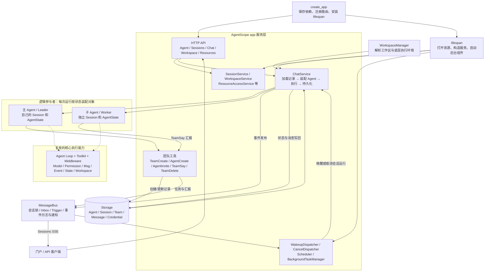

# create_app 机制：AgentScope 2.0.10

本文记录原生机制。已确定的企业改造另见 [改造点草稿.md](./改造点草稿.md)。

企业决策更新（2026-11-03）：framework 管共享 Definition 配置与装配能力，app 管 HTTP 与启动组合；不修改 AgentScope service 源码。发布包新增/升级热加载为首版硬约束，见 [包边界与热加载](./包边界与热加载.md) 和 [V1实施规划](../../egis-agentkit-app/docs/V1实施规划.md)。本文原生机制仍以 v2.0.10 为核对基线。

当前企业数据与执行方案以 [数据结构](./数据结构.md)、[表设计](./表设计草案.md)、[运行流程](./运行流程.md) 为准。特别注意：本版不改 MQ、不做动态团队；PG upsert_session 未传 session_id 时创建新记录，不按 user/agent/workspace 查重复用，不能照抄 Router 注释当实现事实。

若先看“企业运行面到底需要增强什么”，从第 13 节开始：分别按初始化、完整聊天对照原生行为与企业增量；前面的章节用于查具体机制。

核对日期：2026-10-26。基线为本地 `harness/agentscope` 的 v2.0.10，commit `e6c014f0be49b2a6f6f62a9453082a0b975484e1`。本文描述当前源码，不把企业增强方案当作原生能力。

## 1. 核心结论

`create_app` 装配一套持久化、多会话、可后台唤醒的 Agent 服务。它复用核心 Agent 的执行循环，在外层补充 HTTP 接口、配置/会话存储、工作区解析、运行装配、消息投递、事件流、取消恢复、团队协作和组件生命周期。

创建服务、创建 Agent 配置、创建会话、构造运行对象是四个不同动作。默认不会在调用 create_app 时预先创建某个主 Agent 或所有子 Agent。

服务原生支持主 Agent + worker：通过 TeamCreate、AgentCreate、AgentInvite、TeamSay 等工具实现。主/子角色属于团队中的会话关系；实际执行均使用核心 Agent 类，或开发者注入的 custom_agent_cls。

## 2. 服务结构图

箭头表示主要装配、调用或数据关系；虚线表示复用核心执行能力。图中的“运行装配”是 ChatService 内部逻辑，不是建议新增的企业工厂。



图中的主/子 Agent 是逻辑参与者，不表示进程始终持有两个长驻 Python 对象。持久配置和 Session State 保存在 Storage，每次 ChatService.run 装配对象，运行中可处理后续 inbox 内容；下一次运行可重新装配并恢复状态。

## 3. 核心能力之上增加了什么

| 维度       | 核心层直接使用时                    | app 服务层增加的内容                                                       |
| ---------- | ----------------------------------- | -------------------------------------------------------------------------- |
| Agent 构造 | 应用自己调用 Agent(...)             | 根据 AgentRecord、SessionRecord 和扩展工厂自动装配                         |
| 调用入口   | reply / reply_stream                | HTTP 触发、队列触发、定时任务、渠道触发                                    |
| 配置       | Python 代码传入对象                 | 持久 Agent 配置、会话模型配置、凭证解析与资源接口                          |
| 状态       | Agent 持有 AgentState，应用负责保存 | 按会话加载/写回状态和消息，配合事件 checkpoint                             |
| Workspace  | 应用直接提供 Workspace              | Manager 分配绑定、解析工作区，文件和技能/MCP 接口                          |
| 并发       | 应用自己控制运行任务                | 进程内任务注册、MessageBus 会话锁、队列唤醒                                |
| 流式输出   | 直接消费 AgentEvent                 | 会话事件发布、SSE 订阅、重放与状态协调                                     |
| 工具       | 应用自己构造 Toolkit                | 自动加入文件、计划、后台任务、定时、团队、渠道、额外工具和 middleware 工具 |
| 人工确认   | 核心产生确认事件并支持恢复输入      | 持久会话恢复、确认路由、worker 确认投影到主会话                            |
| 多 Agent   | 核心可编程组合，另有 TeamPipeline   | TeamRecord、独立 worker 会话、异步消息、唤醒、清理                         |
| 生命周期   | 应用自己管理连接/后台任务           | lifespan / AsyncExitStack 统一打开和关闭已注册资源                         |
| 附加服务   | 按需自行接入                        | Hub、SOP、Scheduler、渠道、可选知识库与实时语音                            |

核心本身已有多 Agent 组合能力；不能理解为多 Agent 一定要 create_app。服务层的增量是把团队和各参与者的会话、状态、消息及调度组织成服务。

## 4. 从定义到运行：一个 Agent 怎样产生

### 4.1 创建服务应用

```python
app = create_app(
    storage=storage,
    message_bus=message_bus,
    workspace_manager=workspace_manager,
)
```

创建 FastAPI 并保存依赖，注册接口；ASGI 启动阶段才进入 lifespan。此时没有调用模型，也没有根据某个 AgentRecord 构造 Agent。

### 4.2 创建 Agent 配置记录

`POST /agent/` 校验 AgentData，生成 AgentRecord 并调用 storage.upsert_agent，返回 agent_id。

主要内容：name、system_prompt、chat_config；chat_config 包含 ContextConfig、ReActConfig、InviteConfig。AgentRecord 另外记录 user_id、source 等。

这一步创建可持久化的定义，不是创建运行中的 Python Agent 对象。

### 4.3 创建 Session

`POST /sessions/` 校验 Agent 和所引用凭证等资源的可见性，解析 workspace_id，再保存 SessionRecord。

SessionConfig 主要保存 workspace_id、聊天/备用模型配置、可选语音与知识库配置等。SessionRecord 关联 agent_id、team_id，持有会话 AgentState 与来源信息。

workspace_id 的分配不等于计算环境已经启动；具体何时初始化由 WorkspaceManager 实现决定，标准聊天路径在 get_workspace 时取得可用工作区。

### 4.4 提交运行

普通消息通过 `POST /chat/` 交给 ChatRunRegistry，HTTP 返回 started。前端通过 `GET /sessions/{session_id}/stream` 接收事件。

用户确认/外部执行结果等恢复输入先经路由解析真实目标会话，再进入触发队列，由 WakeupDispatcher 发起后续运行。

### 4.5 ChatService 构造运行对象

ChatService 取得会话分布式锁后：

1. 解析 AgentRecord，加载 SessionRecord。
2. 解析 Team/Channel 身份，识别当前是 leader 还是 worker。
3. 通过 WorkspaceManager.get_workspace 得到工作区。
4. 构造 InboxMiddleware、StateChangeMiddleware、ToolOffloadMiddleware；worker 加入 TeamMemberLoopMiddleware，SOP/语音/知识库按条件补充。
5. 调用 extra_agent_middlewares，追加用户自定义 middleware。
6. get_toolkit 汇集 workspace tools、planning、background、schedule、team、channel、extra tools、middleware tools、skills 和 MCP。
7. 根据 SessionConfig 的模型配置解析 Credential，构造模型和 fallback。
8. 拼接 Agent 定义的 system_prompt 与服务会话说明，使用会话中保存的 AgentState 构造 Agent。

关键构造代码等价于源码中的：

```python
agent = self._agent_cls(
    name=agent_record.data.name,
    system_prompt=system_prompt,
    model=model,
    toolkit=toolkit,
    model_config=ModelConfig(fallback_model=fallback_model),
    context_config=chat_config.context_config,
    react_config=chat_config.react_config,
    state=agent_state,
    middlewares=middlewares,
    offloader=workspace,
)
```

默认 _agent_cls 是核心 Agent，也可以使用 custom_agent_cls。参数来源：

| 构造内容                                  | 来源                                        |
| ----------------------------------------- | ------------------------------------------- |
| name、system_prompt、context/react config | AgentRecord                                 |
| 主模型、fallback、credential 引用         | SessionConfig + CredentialRecord            |
| context、权限状态、任务状态               | SessionRecord 的 AgentState                 |
| 文件工具、skills、MCP、offloader          | 解析后的 Workspace                          |
| 团队/后台/计划/渠道等工具                 | app 服务装配                                |
| 企业 middleware、函数工具                 | extra_agent_middlewares / extra_agent_tools |

### 4.6 执行与保存

调用 agent.reply_stream，消费并发布 AgentEvent，累积结果消息。存在 inbox 消息时，当前运行可能继续处理；需要确认时保存待恢复状态。

退出前保存消息和 agent.state，更新事件 checkpoint，并在状态写入完成后释放会话锁。AgentState 是跨运行连续性的依据，不能靠始终复用一个内存 Agent 对象保证连续性。

## 5. 原生主 Agent + 子 Agent

### 5.1 基本模型

“主 Agent”是团队 leader session 所使用的 Agent；“子 Agent”是 worker session 所使用的 Agent。没有专门的 MainAgent 类。

TeamRecord 关联 leader session 和成员名册。一个 Agent 定义可以在不同 session 中领导不同团队；同一个 session 同时只能属于一个 team。worker 的工具集合不包含创建子团队的一整套 leader 工具，因此默认服务团队模式不是无限递归的树。

### 5.2 默认团队工具

| 工具        | 作用                                                      |
| ----------- | --------------------------------------------------------- |
| TeamCreate  | 当前会话建立团队并成为 leader                             |
| AgentCreate | 根据默认/自定义 SubAgentTemplate 创建新 worker 定义与会话 |
| AgentInvite | 将可见且允许邀请的已有 Agent 以新团队会话加入             |
| TeamSay     | 点对点或广播消息；worker 用它向 leader 汇报               |
| TeamDelete  | 取消并清理团队；leader 会话保留                           |

非 worker 的运行默认获得 leader 工具集合，调用工具时仍检查团队前置条件。AgentInvite 仅在有符合条件的可邀请 Agent 时加入；worker 获得 TeamSay，其他普通工作工具仍按装配存在。

### 5.3 AgentCreate：按模板创建新 worker

leader 先调用 TeamCreate，再调用：

```text
AgentCreate(
  name="researcher",
  description="调研指定主题",
  prompt="具体任务、上下文、约束和交付要求",
  subagent_type="researcher"
)
```

工具执行的是：

1. 验证调用者确为团队 leader，校验模板与成员名称。
2. 从 SubAgentTemplate 生成 system_prompt、context/react config，保存 `source="team"` 的新 AgentRecord。
3. 新建 worker SessionRecord / AgentState，关联 team_id。
4. 继承 leader 的聊天/备用模型配置和 workspace_id；权限按模板标志合并。
5. 将首个任务作为 HintBlock 投递 worker inbox，必要时 enqueue wakeup。
6. 返回“成员已创建”；worker 的实际运行由 dispatcher → ChatService 发起。

所以 AgentCreate 不在当前调用栈中同步等待 worker 的完整答案返回。新 worker 按另一个会话运行，可以与 leader/其他 worker 并发。

### 5.4 上下文、模型、文件与权限关系

下表仅描述 AgentCreate 创建的新 worker；AgentInvite 不同。

| 项目                                 | 新 worker 的默认行为                                                                                              |
| ------------------------------------ | ----------------------------------------------------------------------------------------------------------------- |
| AgentRecord / AgentState             | 独立                                                                                                              |
| Session / context                    | 独立；不复制主会话完整聊天历史                                                                                    |
| 首个任务                             | leader 在 AgentCreate.prompt 中显式提供                                                                           |
| 模型 / fallback                      | 继承 leader SessionConfig                                                                                         |
| system_prompt / context/react config | 来自选中的 SubAgentTemplate                                                                                       |
| workspace_id                         | 与 leader 相同                                                                                                    |
| Skills / MCP                         | 仍按 workspace.list_skills(agent_id)、list_mcps(agent_id, session_id) 解析；共享 workspace 不等于所有绑定完全相同 |
| 权限                                 | 默认模板跟随 leader；自定义模板可控制 mode、规则、工作目录的继承方式                                              |
| 结束与清理                           | 一轮完成后可继续接任务；TeamDelete 时删除创建型 worker 定义与其会话                                               |

共享 workspace 提供协同文件能力，不提供子 Agent 之间的文件写冲突隔离。企业需要更小目录作用域时，应在 Workspace/执行权限增强中补充。

### 5.5 消息、唤醒与汇报

TeamSay 将成员信息封装为 HintBlock，通过 deliver_to_inbox 投递。收件会话正在运行时，由 InboxMiddleware 在 reasoning 前读取；会话空闲时由触发队列和 WakeupDispatcher 启动 ChatService.run。

worker 不会把全部中间推理直接作为主 Agent 上下文。需要主 Agent 看到的结果通过 TeamSay 发送，主 Agent 再进行综合与回复。

TeamMemberLoopMiddleware 检查 worker 结束前是否成功向 leader/broadcast 汇报。没有汇报则有限次数提醒继续，超过上限以错误结束；worker 执行失败/中断时，ChatService 也有通知 leader 的路径。这是原生服务已补充的协调逻辑。

leader 不需要一直保持同一个 HTTP 请求等待子任务。子任务结果可以注入当前运行，也可以在 leader 空闲后触发新的运行；应用若需要严格“所有子任务完成后才交付”的产品语义，还需明确相应执行/交付策略。

### 5.6 子 Agent 的人工确认

worker 的 ASK 状态在自己的 Session State 中。SubagentHitlProjector 将待确认请求投影到 leader session，前端可以从主会话看到；用户回答后，聊天路由解析真实 worker session 并通过队列恢复它。

投影只镜像指定 HITL 事件，不代表 worker 的全部 token/工具过程都会自动合并到 leader 的事件流。查看全部 worker 过程需要订阅/查询对应会话或额外设计展示聚合。

### 5.7 AgentInvite：复用已有专家

与 AgentCreate 的区别：

- 不新建 Agent 定义，复用已有且可见/允许邀请的 AgentRecord。
- 为团队创建独立 borrowed session，原 Agent 其他会话的历史和权限状态不直接复制。
- workspace/model 从调用者自己已有的该 Agent 会话取得；没有时按 manager 分配工作区，模型回退到 leader。跨所有者邀请不会拿原所有者会话里的 workspace/MCP/缓存。
- 不自动继承 leader 的权限上下文，避免跨工作区复用授权。
- 团队解散只删除 borrowed session，保留原 Agent 定义。

该机制可作为“已有专家”的执行基础，目录发布授权管理仍是外部治理职责。

## 6. SubAgentTemplate 支持范围

create_app 的 custom_subagent_templates 用于注册数据模板；启动时不预先实例化所有 worker。AgentCreate 执行时通过 subagent_type 选取模板。

当前模板字段包括 type、description、system_prompt_template、context_config、react_config、permission_context、tasks_context，以及权限继承标志。

当前没有独立的 model、skills、MCP、tool bindings 字段。AgentCreate 直接继承 leader 模型与 workspace；按专家自定义这些能力需要利用其他运行扩展点或做有针对性的增量，不能把模板当成完整的专家运行规格。

## 7. 与核心 TeamPipeline 的区别

| 项目        | 核心 TeamPipeline                     | create_app 的服务团队                           |
| ----------- | ------------------------------------- | ----------------------------------------------- |
| 定义方式    | 应用传入 leader 和 members 对象       | 持久 Agent/Session/Team 记录；工具动态创建/邀请 |
| 分工        | leader 使用 TeamAssign                | TeamCreate + AgentCreate / AgentInvite          |
| 结果返回    | 子任务最终结果作为工具结果返回 leader | TeamSay → inbox → 当前运行消费或异步唤醒        |
| 生命周期    | Pipeline 管理本次组合执行             | 会话级团队，可多轮继续协作，显式清理            |
| 持久化/HTTP | 应用负责服务化                        | app 提供存储、HTTP、SSE、运行任务协调           |

create_app 当前默认 ChatService 不会把 Agent 自动包装为 TeamPipeline；这两条原生路径分别服务于不同装配方式。

## 8. AgentRecord、SessionRecord、Msg、Event 的关系

AgentRecord、SessionRecord 是 app 服务层的持久化模型。Agent、AgentState、Msg、AgentEvent 属于核心执行能力。

```text
AgentRecord：Agent 定义
    ↑ SessionRecord.agent_id 引用
SessionRecord：会话
    ├── config：模型、工作区等配置
    └── state：AgentState
        ├── context：list[Msg]
        ├── summary：压缩摘要
        ├── permission_context
        └── tasks_context

独立会话消息存储：
    (session_id, msg_id) → Msg
```

一个 Agent 定义可以关联多个 Session，运行状态保存在 Session 内，不是在 AgentRecord 内嵌套保存 Session。10 个 Agent 定义原生对应 10 条 AgentRecord，不要求对应 10 个配置文件；配置文件/Nacos 到 Record 的映射属于应用接入选择。

标准请求用 agent_id 选择定义、session_id 选择会话。ChatService 加载两者，再把定义、状态、模型、工具与 middleware 装配成核心 Agent。不同 AgentID 默认可以使用同一个 Python Agent 类，不会按 ID 自动 import 不同代码类。

Msg 不专属于 Agent：它既可以出现在 AgentState.context，也可作为 API 输入、服务消息记录。当前推理上下文与历史消息记录不是同一份列表；压缩会改变上下文，但不等于删除独立保存的历史消息。

Event 表达执行过程中的变化，含类型、关联标识和对应数据，来源包括模型、工具、权限与运行生命周期。

```text
Agent 执行
  ├── 更新自身 AgentState/context
  └── reply_stream 产出 AgentEvent
          ├── ChatService 应用到回复 Msg
          └── 发布到会话事件流 → 前端

退出前：
  ├── upsert_message：保存消息
  └── update_session_state：保存 AgentState
```

Msg.append_event 是把事件应用为文本块、工具状态、usage、结束信息等变化，不是把 Event 对象原样放进 Msg。reply_id 不匹配会跳过；没有对应分支的事件也不会形成消息内容。Msg 未接受某个事件，不等于服务必然不发布这个事件。

当前原生服务没有统一的“内容审核通过才发前端”关卡。会话访问检查、事件结构检查、权限裁决与企业内容审核是不同职责。

源码细节：当前 SQL get_session 校验用户归属，但忽略传入 agent_id；ChatService 的这条调用路径不能被理解为已经强制校验 agent_id 与 session.agent_id 一致。增强入口需要明确该一致性约束。此处记录事实，不将它自动列为已确认的独立改造点。

## 9. 主 Agent 如何选择 Skill 或子 Agent

原生没有独立的 Skill/专家确定性路由器，主 Agent 模型根据任务、system_prompt、上下文和能力描述进行选择。

| 能力           | 模型看到的信息                               | 使用方式                                 |
| -------------- | -------------------------------------------- | ---------------------------------------- |
| Skill          | 名称、description、目录                      | 先通过技能查看工具读取全文，再按说明执行 |
| 子 Agent 模板  | AgentCreate 工具及 subagent_type 的说明/枚举 | 创建相应类型的 worker                    |
| 已有专家 Agent | AgentInvite 中可邀请目标的说明与枚举         | 邀请相应专家并投递任务                   |

Skill 提供工作方法；worker 提供独立上下文和执行任务的参与者。两者可以组合，worker 也可以使用自己的 Skills。主会话挂载模板不等于启动全部 worker。

是否委派、如何拆任务、选择哪个专家由模型判断，框架负责工具执行和协作机制。强制路由规则需要另行实现，不能仅靠 description 保障。

## 10. 前端传入与后端默认：模板的原生支持范围

这里仅讨论子 Agent 模板，不代表 AgentScope 所有配置都不能由前端管理。

| 来源                                                 | 当前原生支持             |
| ---------------------------------------------------- | ------------------------ |
| 后端不配置模板                                       | 自动补充内置 default     |
| 后端传 custom_subagent_templates                     | 启动装配时注册自定义模板 |
| 后端注册 type=default                                | 替换内置默认模板         |
| AgentCreate 未指定 subagent_type                     | 使用 default             |
| AgentCreate 指定不存在的类型                         | 返回错误，不静默降级     |
| 前端随 Chat/Session 请求传完整模板或本次模板选择集合 | 当前 schema 没有对应字段 |

原生可以通过 Agent API 管理已有 Agent 定义并设置邀请信息，再由 AgentInvite 使用；这是另一条已有路径，不等于前端传入 SubAgentTemplate。

“默认兜底、是否允许前端传、传入格式、会话级可用集合”已讨论为待设计的配置契约，但尚未作为编号改造点确认。create_app 的模板参数本身不提供这套规则。

## 11. MessageBus：通信、事件流和分布式协调

### 11.1 与 Storage 的分工

Storage 保存 Agent 定义、会话状态、消息历史等持久事实。MessageBus 提供队列、事件日志、广播、锁和 registry；后台 dispatcher 使用这些能力触发实际运行。MessageBus 本身不执行 Agent。

总线中的 payload 不只有核心 Msg：包含 HintBlock、序列化 AgentEvent、运行触发数据、取消信号等。

原生实现只有 InMemoryMessageBus 和 RedisMessageBus。InMemory 的锁、Inbox、日志和订阅者均在当前进程内，不能直接用于共享会话的多进程/多副本；共享数据库不会自动共享总线状态。

### 11.2 SSE 与聊天提交分离

```text
前端打开 GET /sessions/S1/stream?agent_id=A1
    → 建立并保持 SSE 收消息连接

用户点击发送：POST /chat/
    → 传 agent_id、session_id、input
    → 返回 started
    → 后台执行 Agent
    → 事件从原先的 GET 长连接推送
```

下一轮发送新的 POST，可以继续使用原来的 GET 长连接。POST 的 started 只表示已提交，不代表模型执行成功。

多实例情况下，POST 可以落到 A，SSE 从一开始由 B 持有。A 发布事件到共享总线，B 收到后写入自己的 SSE。没有把 A 的 HTTP 连接迁移或复用给 B。

AgentLoop 在 A 内部转多轮时，Agent 对象、context 和工具缓存继续在 A。B 只转发事件，无需重建完整 Agent；新的运行若由 B 接手，才从 Storage 加载状态并装配。

### 11.3 原生事件发布与订阅

publish_session_event 使用按 Session 命名的 key：

```text
agentscope:session:events:<session_id>
    ├── log_append：事件重放日志
    └── publish：实时广播
```

RedisMessageBus 中，前者使用 Redis Stream 的 XADD，后者使用 Redis Pub/Sub 的 PUBLISH。SSE 入口先启动订阅，再读取重放日志，通过内部 entry_id 去重，然后持续转发实时事件。

Redis 按频道分发，不需要 MessageBus 维护“这个 SSE 归哪台实例”的全局映射。B、C 都订阅 S1 就都能收到；只订阅 S2 的 D 收不到 S1。每个订阅协程绑定自己的 SSE 连接。

事件日志默认近似上限 1000 条，并随消息/状态 checkpoint 裁剪，不是全量审计日志。SSE 连接内部另有 asyncio.Queue 作为转发缓冲；这与运行触发队列不是同一种用途。

### 11.4 当前边界

- 普通 Redis Pub/Sub 是瞬时广播，离线漏收不会由 Pub/Sub 自动重发。
- 原生日志写入与广播是两次独立操作；当前 SSE 没有持续按游标补拉的闭环。
- SSE 内部 Queue 没有上限；每条 SSE 的独立 Pub/Sub 订阅也需要容量评估。
- 原生 RedisMessageBus 初始化普通 Redis 客户端，不直接支持 RedisCluster；存在兼容代理入口不等同于已经适配原生 Cluster。
- 原生相关总线测试主要使用 fakeredis，不能代替真实集群故障与容量验证。

后续集群方案命名为 EgisMessageBus，详见 [改造点草稿.md](./改造点草稿.md)。本版不实施 MQ 替换，单进程使用原生 InMemory；会话锁的配置作用域窄适配不重新实现通信/队列/锁算法。

## 12. egis-agentkit-framework 的增量边界

可直接复用：Agent 实例装配、会话状态恢复、默认 Toolkit 汇集、团队工具、inbox/wakeup、worker 汇报要求、HITL 投影、事件流和已注册资源的 lifespan。

需要企业实现的主要是：Definition 配置管理与原生配置适配、版本化发布包 Loader/Registry、Turn 装配上下文、Workspace/模型/权限等企业接入。通过原生公开工厂、Storage/Workspace 委托和 middleware 完成接入；不修改 service 源码，不复制 ChatService、AgentLoop 或团队调度器。

此前“增强都能在 create_app 配置”应理解为主要增强有注入入口，不代表所有细分需求都有独立开关。例如每个专家独立模型、最终 Toolkit 的完全替换、选择原生路由子集，目前没有通用参数，需要按具体需求核对后做最小增量。

运行面工作已在 [改造点草稿.md](./改造点草稿.md) 总表分为 001—014；编号用于区分事项，设计状态与实施状态单独标注。EgisMessageBus 的方案已确定，014 的新增/升级包热加载硬约束已确定；其他具体方案按讨论逐项细化。

## 13. 企业运行面对照：初始化与完整聊天

本节对应最初的企业架构要求，说明原生现状与可用接入位置。企业改造目标、设计方式及改后流程统一见 [改造点草稿.md](./改造点草稿.md) 的 001—014 总表；详细方案仍需逐项细化，本文不表示代码已实现。

这里的“运行面 service”特指 AgentScope app 的 ChatService、SessionService、WorkspaceService、ResourceAccessService 及其后台组件。共享的 Definition 创建、修订、发布、版本绑定和规则放在 egis-agentkit-framework.AgentService；app 中的 manager_router/Controller 为可选 HTTP 入口。AgentService 不重写聊天或团队执行，原生已完成的流程继续复用。

### 13.1 先分清三次“初始化”

1. **服务进程启动**：打开共享组件，建立服务和后台消费者；此时没有具体会话的 Agent 对象。
2. **Agent 定义与 Session 就绪**：把可运行的 Agent 定义、凭证和会话配置准备好；定义由谁发布，与进程启动是两件事。
3. **每次会话运行装配**：用户发消息或会话被唤醒后，读取记录，取得 workspace，装配实际 Agent，再进入循环。

不要把它们合成“启动时初始化所有 Agent、沙箱、MCP”。原生大量资源按需取得；一次运行中的多轮模型调用不重复整套装配。

### 13.2 服务进程初始化：原生流程与企业接入

```text
应用读取企业配置、准备组件对象                 ← 企业接入
              ↓
调用原生 create_app(...)                      ← 保留
              ↓
注册凭证类型、保存依赖、绑定 Storage、注册路由
              ↓
ASGI 启动 → 原生 lifespan
              ↓
打开 Storage → MessageBus → WorkspaceManager
打开已配置的 Hub / 可选组件
              ↓
创建后台任务管理、运行任务登记、Scheduler
创建资源访问、聊天、会话、工作区等 Service
              ↓
启动唤醒、取消等后台订阅 → 接受请求
```

| 顺序                       | 原生已经做什么                                                                                                                                                   | 企业运行面需要接入/增强什么                                                                                                        | 最小接入位置                                                                      |
| -------------------------- | ---------------------------------------------------------------------------------------------------------------------------------------------------------------- | ---------------------------------------------------------------------------------------------------------------------------------- | --------------------------------------------------------------------------------- |
| A0：调用 create_app 之前   | 接收 Python 组件和参数；不自行从 Nacos 加载企业规则                                                                                                              | 从 Nacos 读取并校验运行配置，解析环境与凭证引用；明确配置版本和生效规则                                                            | 应用 bootstrap + 配置 adapter；不必重写 create_app                                |
| A1：调用 create_app        | 注册 extra_credentials，创建 FastAPI，保存依赖，workspace_manager.bind_storage，校验模板类型，注册原生路由与额外 ASGI middleware                                 | 注入企业 WorkspaceManager、EgisMessageBus、PA_JT 凭证类型、访问策略、middleware/tools 工厂、可选协议转换；集群共享 download_secret | 原生参数；认证依赖还可用 FastAPI dependency_overrides                             |
| A2：ASGI lifespan 打开资源 | AsyncExitStack 顺序打开 Storage、MessageBus、WorkspaceManager，以及已配置 Hub/可选资源                                                                           | 各 adapter 在自己的生命周期里打开企业 MQ/Redis、沙箱服务客户端、资源目录客户端等                                                   | 现有组件的异步生命周期；额外客户端由应用组合生命周期负责，不覆盖原生启动/退出流程 |
| A3：构造管理器和 Service   | 创建 BackgroundTaskManager、ChatRunRegistry、SchedulerManager、ResourceAccessService、ChatService、RealtimeService、SessionService、SOPService、WorkspaceService | 大多数直接保留；这些对象主要组织本进程的运行，不是待重建的企业治理后台                                                             | 继续使用原生装配，无需给每个 Service 再套一层                                     |
| A4：启动后台任务           | 启动 WakeupDispatcher、CancelDispatcher；Scheduler 按开关运行；渠道、知识库按配置启用                                                                            | 多实例明确 Scheduler 由谁运行；不需要的渠道/知识库不启用。MQ 后端须使原生订阅正常就绪                                              | enable_scheduler、enable_channel_worker 等部署配置；知识库不传 manager            |
| A5：接受请求和关闭         | 启动完成后接受请求；退出时按逆序关闭组件和任务                                                                                                                   | 企业额外连接、记忆实例缓存、配置监听也要有归属与关闭责任                                                                           | adapter 生命周期和应用生命周期组合；并非所有 Agent middleware 都会自动被关闭      |

原生 create_app 不自动创建企业 chat Agent、不发布十个业务 Agent、不从 Nacos 同步 AgentRecord，也不预先给每个用户分配沙箱。

Agent 定义和凭证可以由管理服务通过原生 API/Storage 协议发布；若应用启动时做同步，必须约定稳定 ID、版本及幂等更新，不在每个副本启动时无条件覆盖运行记录。Nacos 保存企业配置/规则，Storage 保存运行记录和会话状态，两者需要映射而不是互相替代。

### 13.3 聊天前的准备：原生对象如何对上企业配置

| 对象          | 原生来源/能力                                                                            | 企业需要定下的规则                                                                                                                                        |
| ------------- | ---------------------------------------------------------------------------------------- | --------------------------------------------------------------------------------------------------------------------------------------------------------- |
| Agent 定义    | AgentRecord：名称、system_prompt、context/react/invite 等配置；前端以 agent_id 选择      | 哪些是企业发布的 Agent、谁可使用/修改、版本与 ID 如何稳定；无需每个 Agent 再部署一个服务                                                                  |
| 会话          | 创建 Session 时引用 agent_id，保存模型配置、workspace_id 和 AgentState                   | 服务端默认值、允许用户覆盖的字段、覆盖范围与校验；配置选定后把结果保存下来，不能每轮临时猜默认值                                                          |
| 主/备用模型   | SessionConfig 引用 credential_id、model、parameters；运行时经 CredentialFactory 构造模型 | PA_JT Credential 与模型构造协议适配，凭证保管与可用场景限制                                                                                               |
| Workspace     | Manager 分配/解析 workspace_id，原生有 per_session / per_agent / per_user 隔离选项       | 企业方案支持 local / sandbox；明确用户目录、逻辑 workspace_id、物理目录或 sandbox_id 的对应关系；共享用户目录不意味着共享同一个可变 Python Workspace 对象 |
| Skills / MCP  | Workspace 运行时列举；资源库与 workspace 安装是两层                                      | 企业默认 + 用户选择如何合并，哪些资源禁用，公共 Skill 的只读共享、版本与同名冲突规则                                                                      |
| 子 Agent 模板 | create_app.custom_subagent_templates 注册到应用级；聊天请求本身不接收模板                | 默认/允许类型、每个主 Agent 可用的专家范围、用户是否能覆盖；不能把“后端可注册模板”理解为“每次前端可传模板”                                                |

**原生聊天请求只有 agent_id、session_id、input。** 模型等设置在创建/更新 Session 的 API 中；Skills/MCP 在各自的 workspace API 中。若门户需要一次请求携带全部设置，应有一处很薄的请求校验与原生配置写入适配；不要让 SDK 暴露第二套 Agent/Session 模型。

### 13.4 一次完整聊天：原生 service 增强了什么，我们补什么

```text
可信身份 + 允许的请求配置                      ← 企业入口校验
              ↓
POST /chat/ → 原生启动本机运行任务，返回 started
              ↓
Session 锁 → 加载 AgentRecord / SessionRecord
              ↓
取得 workspace → 装配 middleware / toolkit / model
              ↓
构造原生 Agent，带上会话 AgentState
              ↓
原生 reply_stream：模型 ↔ 工具，多轮执行
              ↓
事件累积到消息；写重放日志并广播 → 独立 SSE
              ↓
处理 Inbox / 等待确认 / 结束交接
              ↓
保存消息与状态 → 更新 checkpoint → 释放 Session 锁
```

| 阶段                | 原生 app 相对“直接调用核心 Agent”增加的工作                                                                             | 企业运行面需要做的增量                                                                                                        |
| ------------------- | ----------------------------------------------------------------------------------------------------------------------- | ----------------------------------------------------------------------------------------------------------------------------- |
| B1：入口            | `/chat/` 识别普通输入与确认恢复；普通输入交本机 ChatRunRegistry，恢复输入进共享触发队列                                 | 对接公司身份和 tenant/user；校验 Agent、Session、workspace 关联及允许的覆盖字段；不要仅信任前端 X-User-ID                     |
| B2：串行与加载      | ChatService 获取 Session 锁后，解析可访问 Agent、Session、Team/Channel 身份                                             | 注入企业资源访问策略；底层是 EgisMessageBus。不要复制原生会话装载逻辑                                                         |
| B3：取得执行环境    | WorkspaceManager.get_workspace 获取已初始化 Workspace；把 workdir 加入会话工作目录权限                                  | local 复用本地执行并适配目录/用户绑定；sandbox 接企业沙箱分配/重连、NAS 挂载、pool；两者统一目录规则、权限和使用记录          |
| B4：装配 middleware | 自动放 Inbox、StateChange、ToolOffload；worker 加汇报约束；语音/知识库/SOP 按条件加入；调用 extra_agent_middlewares     | 追加企业权限、偏好、记忆、追踪/审计增强。ReMe 与 Tracing 已有原生实现，优先复用                                               |
| B5：装配 Toolkit    | 汇集 workspace 工具、计划、后台控制、定时、团队、渠道、extra tools、middleware tools；加载 Skills/MCP                   | 企业资源默认值与用户启停解析；函数工具按权限返回；最终调用仍需权限检查。extra_agent_tools 仅追加工具，不是完整 Toolkit 过滤器 |
| B6：模型与 Agent    | 由 Session 配置解析凭证，构造主/备用模型；拼接基础提示，传入保存的 AgentState，构造核心 Agent                           | PA_JT 的 Credential/Model adapter；提示偏好通过 on_system_prompt 合入。一般不需要 custom_agent_cls                            |
| B7：多轮执行        | 调用核心 reply_stream，处理 Inbox 与工具后台化；核心层负责模型/工具循环、Permission、上下文压缩和卸载                   | 在 on_check_permission / on_model_call / on_acting 等现成位置执行企业规则；沙箱也必须执行自己的文件/命令隔离                  |
| B8：事件与前端      | ChatService 消费 AgentEvent，先累积 Msg，再发布会话事件；SSE 独立订阅、补读；middleware 发布界面状态事件                | 复用原生事件；按门户选择原生 SSE 或 AGUI 转换，交付等新增业务语义优先 CustomEvent；完整审计另行持久化                         |
| B9：协作/确认分支   | Team 工具创建 worker 记录与 Session；Inbox + 唤醒安排运行；确认投影到 leader，恢复输入回正确 worker                     | 默认团队流程保留；补“允许哪些专家、可继承哪些资源”的企业策略，必要时再做模板/资源解析的局部扩展                               |
| B10：收尾           | 检查 Inbox 消费交接；在 checkpoint 锁内保存历史 Msg 与 AgentState，更新游标、裁剪日志，最后释放运行锁；异常路径也有清理 | 业务结果交付、长期记忆同步、企业审计落库按其责任补接；不要再实现一份会话保存和循环恢复                                        |

一次 run 内可能因待处理 Inbox 再调用 reply_stream；它不是每个 token 或每次模型调用都重新创建 Agent。下一次 run 才可从持久状态重新装配。

企业增量必须在装配前固定同一份完整 Definition 配置快照和发布包版本，并让 tools/middleware/Skills/MCP 共用；不是仅在 on_reply 内读取一次最新版。未完成执行的确认恢复沿用原快照，具体外挂契约在 M0 验证，不修改 service 源码。首版不持久化编辑中草稿，也不提供配置历史回退。

### 13.5 按最初需求逐项判定运行面增量

| 企业需求                                    | 原生现状                                                                                                                                              | 建议的运行面增量及边界                                                                                                                                                                               |
| ------------------------------------------- | ----------------------------------------------------------------------------------------------------------------------------------------------------- | ---------------------------------------------------------------------------------------------------------------------------------------------------------------------------------------------------- |
| Nacos / bootstrap / 默认兜底 / 是否允许传入 | 接受启动参数与各类记录；没有统一的 Nacos 配置源和企业覆盖规则                                                                                         | 配置 adapter + 规则校验；区分进程配置、Agent 发布版本、Session 生效配置。发布包新增/升级必须在主 App 不重启时生效；Loader/版本快照由 framework 实现，不把它说成原生已有能力                                                                           |
| Workspace local / sandbox、目录布局         | 已有 LocalWorkspace/LocalBackend 及 WorkspaceManagerBase / WorkspaceBase / BackendBase；OpenSandbox 实现可参考；默认根下 .mcp、data、skills、sessions | local 复用原生本地执行，sandbox 接企业沙箱/NAS；共同适配公共/用户路径、共享与权限规则。workspace.mode 与 standalone/cluster 独立配置                                                                 |
| 公共 Skills + 用户 Skills                   | 默认 Skills 按 Agent 分区，skill_paths 为种子复制；原生 Toolkit 支持 SkillLoader，但 service 默认传入 Workspace 列表 | 专家配套资源只读共享且不加载个人技能；个人助理可动态发现个人安装技能；自建专家只用明确绑定集合。通过公开 Workspace/Loader/middleware 接入，不每用户复制公共资源；详见 Workspace与用户资源范围 |
| work / artifacts                            | 原生工作根目录可操作文件，但没有“草稿 → 正式交付”的业务状态                                                                                           | 建议先分 work/ 与 artifacts/：同一用户根下分别承担编辑和交付；通过明确提交/登记动作生成交付元数据，下载复用原生文件能力并补访问规则。不是改名即可自动交付                                            |
| memory / ReMe / 数据库同步                  | **已提供 ReMeMiddleware**，自动记忆写回与检索；另有 AgenticMemoryMiddleware（MEMORY.md 路线）；app 不默认装入，也未实现本需求的 NAS + 数据库副本同步  | 通过 extra_agent_middlewares 接 ReMe，补 user/Agent 作用域、模型与实例生命周期、路径可达性和同步策略；首版使用 ReMe；不把 memory.md 当成另一份记忆真源                                                               |
| PA_JT 公司推理服务                          | get_model 从 Credential 类型定位模型类；可通过 extra_credentials 注册                                                                                 | 实现匹配 get_model 构造协议的 Credential/Model adapter；复用现有 PA_JT 签名 transport 思路，不重写模型循环和原生流式事件                                                                             |
| 企业权限                                    | 已有工具 Permission/HITL、on_check_permission、资源访问策略；默认身份是临时 X-User-ID；资源访问策略的资源类型仅 Credential/Agent/KnowledgeBase        | 可信身份依赖 + 企业访问策略 + 执行时权限 middleware；Skills/MCP/函数工具的权限要在对应资源解析/执行边界补，不能只传 resource_access_policy 就认为全覆盖                                              |
| MCP / 函数工具 / Skills 启停                | 原生有用户资源库、workspace 安装/移除、Toolkit 管理；MCP 库有 enabled 字段，但聊天装配直接读取 workspace 配置                                         | 外挂管理负责注册、发布、上下架；运行面负责有效资源列表与执行校验。库记录变化不是现有 workspace 的自动联动，需定义版本/禁用传播与生效时机                                                             |
| 专家管理                                    | 应用级 SubAgentTemplate + AgentCreate；已有 Agent 可通过 AgentInvite 加团队                                                                           | 管理端发布模板/专家定义；运行面限制可用范围。每个专家独立模型/skills/MCP、按主 Agent/用户动态模板不是当前模板字段，按实际需求局部扩展，先不重写团队执行                                              |
| 偏好                                        | 可用 Agent.system_prompt，middleware 有 on_system_prompt；AgenticMemory 有 MEMORY.md 路线；未见 app 自动解释用户设想的四份偏好文件                    | personal_config 引用 agent.md/soul.md/user.md 并按权限合入提示；长期记忆通过 ReMe 单独管理                                                                                                        |
| Workspace 管理页面                          | Manager 有获取/关闭/隔离职责；TracingMiddleware 提供运行、模型、工具 span；没有本需求的企业沙箱服务/pool/在线使用总览                                 | 运行面输出 workspace/sandbox/pool/user/session 对应关系及分配、连接、使用、回收记录；外挂服务聚合展示。活跃使用通过租约/心跳或访问状态判断，不能把 get_workspace 到 close 的总跨度直接当用户使用时长 |
| 留痕与观测                                  | 原生有 TracingMiddleware；回放日志会裁剪，和 tracing 都不自动构成完整业务审计库                                                                       | 配置 OTel 并注入原生 Tracing；额外记录企业身份、资源版本、授权/拒绝、交付等审计事件；沙箱文件/命令活动由 Backend/沙箱采集配合                                                                        |
| AGUI / A2UI / custom                        | 已有 AGUIProtocolMiddleware 将 SSE 中 AgentEvent 转为 AGUI；它不重写 ChatRequest，也不是完整 A2UI 交互引擎                                            | 前端先对接原生请求/事件语义，需 AGUI 时启用转换；A2UI 的 UI 描述/动作由业务定义并优先用 CustomEvent/现有确认或外部执行流程承载；转换并发状态需要单独验证                                             |
| 业务记录持久化                              | Storage 已保存 Agent/Session/Msg/Team/Credential 等，Workspace 负责部分卸载文件                                                                       | 接公司数据库时优先配置现有 Storage；确有不兼容才适配 StorageBase。不再把所有记录平行存一遍；sessions/context.jsonl 是上下文卸载文件，不是全部会话状态的替代品                                        |

### 13.6 几个会影响实现方式的真实边界

**工具过滤有两处责任。** workspace.list_tools/list_skills/list_mcps 和 extra_agent_tools 可以控制它们各自提供的资源；原生 get_toolkit 还会自动加入规划、后台、团队、定时等工具。若企业规则需要隐藏/禁用这些工具，先考虑原生 on_reply 中操作已装配的 Toolkit（如 remove_tool）和 on_check_permission 拦截执行，并验证工具组/元工具可见性；只有现成位置满足不了要求，才增加“装配后策略处理”这一个窄接口。不为此复制整个 get_toolkit 或 ChatService。仅在提示里写“禁止使用”不构成执行限制。

**原生动态工具不是首版企业团队规则。** custom_subagent_templates 是应用级注册，AgentInvite 会立即投递任务并唤醒。首版不开放动态组团/增员工具，以原生 Record/Storage 先创建固定成员，orchestrator 用户投影作主理人；之后 TeamSay/Inbox/执行仍由原生完成。不热改私有模板映射或复制 service。

**ReMe 路径和关闭需要额外装配。** ReMeMiddleware 接受 workspace_dir，但没有像 AgenticMemoryMiddleware 那样接受 Workspace Backend；传沙箱内 NAS 路径不代表 API 进程中的 ReMe 就能访问。需要确定 memory 路径对 ReMe 进程可达，或使用单独的记忆接入适配。它的模型在 middleware 构造时固定，不能假设自动沿用聊天模型；它提供 close，但 Agent middleware 没有被 app lifespan 自动统一关闭。不要每次装配都无归属地新建一个长期存活实例，也不要仅凭 session_id 就认定共享目录内的用户/Agent检索隔离已经完成。数据库同步不是它现成的双写开关。

**用户目录根与默认工作目录应区分。** 原生文件工具、权限、卸载路径都与 workdir 有关联。若 workdir 直接改到 user/work，原生 data/skills/sessions 等派生路径也会随之改变；不能只配置一个 workdir 就同时得到所设计的同级目录。更小的方案是保留用户根作为存储布局根，分别配置命令 cwd 与可访问范围，或对确需改变的派生路径做局部 Workspace 扩展。公共 Skills 的共享目录也要通过沙箱挂载/Backend 真正可访问。

**认证和运行授权是两层。** HTTP 身份适配负责“请求是谁发的”；后台唤醒和子 Agent 也要能依据 user_id 与持久化策略重建权限，不能只依赖原 HTTP 请求的临时上下文。资源访问策略检查可引用对象，on_check_permission 检查具体工具动作，沙箱限制最终文件和命令范围。原生 SQL get_session 也没有完整核对传入 agent_id，企业入口应校验 Session 归属关系。

**原生提供集群协调原语，不代表所有后台行为自动具备 HA。** Scheduler 的计时器在进程内，原生要求通过 enable_scheduler 指定运行者；新增 MQ 不会自动选主。其是否需要企业调度接入/选主另行确认。MessageBus 的 ack-on-read 队列、内存中的运行任务和后台工具也不自动获得进程崩溃后的完整业务恢复。

### 13.7 建议实施顺序与不需要重写的部分

先让主线能运行：**配置来源/默认规则 → 企业 Workspace 与 PA_JT → 企业身份/权限 → 原生 create_app 聊天。** EgisMessageBus 是已确认的并行基础设施设计项，多实例联调时接入；standalone 调通时直接复用 InMemory。

首版实施顺序以 [V1实施规划](../../egis-agentkit-app/docs/V1实施规划.md) 为准：先评审数据/表/流程，再验证不改 service 的选版/视图/固定团契约，之后实现管理、按需资源、热加载、Demo 和前端。首版不默认接 Redis，使用原生 InMemory；MQ、整轮跨进程 Worker 不作为本版已解决能力。

保留原生：create_app/lifespan 的基础装配、ChatService 记录加载与 Agent 构造、AgentLoop、Msg/Event/State、会话保存/checkpoint、Inbox/唤醒调度、团队工具与人工确认、Workspace 已有文件与卸载算法。新增的主要是企业 adapter、规则解析与 middleware；当前没有理由先建立另一套 EnterpriseRuntime、Agent 工厂或 Team 调度器。

## 14. 关键源码位置

- [create_app 入口与参数](/Users/frankie/Documents/work/workspace/ai-app/harness/agentscope/src/agentscope/app/_app.py:113)
- [lifespan 资源和服务装配](/Users/frankie/Documents/work/workspace/ai-app/harness/agentscope/src/agentscope/app/_lifespan.py:38)
- [创建 Agent 配置](/Users/frankie/Documents/work/workspace/ai-app/harness/agentscope/src/agentscope/app/_router/_agent.py:175)
- [创建 Session](/Users/frankie/Documents/work/workspace/ai-app/harness/agentscope/src/agentscope/app/_router/_session.py:294)
- [ChatService 的运行装配](/Users/frankie/Documents/work/workspace/ai-app/harness/agentscope/src/agentscope/app/_service/_chat.py:786)
- [构造实际 Agent 对象](/Users/frankie/Documents/work/workspace/ai-app/harness/agentscope/src/agentscope/app/_service/_chat.py:1179)
- [Toolkit 和团队工具装配](/Users/frankie/Documents/work/workspace/ai-app/harness/agentscope/src/agentscope/app/_service/_toolkit.py:40)
- [SubAgentTemplate](/Users/frankie/Documents/work/workspace/ai-app/harness/agentscope/src/agentscope/app/_types.py:140)
- [AgentCreate 与 worker 记录创建](/Users/frankie/Documents/work/workspace/ai-app/harness/agentscope/src/agentscope/app/_tool/_agent_create.py:407)
- [AgentInvite](/Users/frankie/Documents/work/workspace/ai-app/harness/agentscope/src/agentscope/app/_tool/_agent_invite.py:141)
- [TeamSay](/Users/frankie/Documents/work/workspace/ai-app/harness/agentscope/src/agentscope/app/_tool/_team_say.py:83)
- [InboxMiddleware](/Users/frankie/Documents/work/workspace/ai-app/harness/agentscope/src/agentscope/app/middleware/_inbox_middleware.py:25)
- [Worker 汇报约束](/Users/frankie/Documents/work/workspace/ai-app/harness/agentscope/src/agentscope/app/middleware/_team_member_middleware.py:21)
- [子 Agent 人工确认投影](/Users/frankie/Documents/work/workspace/ai-app/harness/agentscope/src/agentscope/app/_service/_projectors/_subagent_hitl.py:44)
- [团队解散与按角色清理](/Users/frankie/Documents/work/workspace/ai-app/harness/agentscope/src/agentscope/app/_service/_session.py:421)
- [核心 TeamPipeline](/Users/frankie/Documents/work/workspace/ai-app/harness/agentscope/src/agentscope/pipeline/_team_pipeline.py:110)

- [AgentState 与消息上下文](/Users/frankie/Documents/work/workspace/ai-app/harness/agentscope/src/agentscope/state/_state.py:209)
- [Msg.append_event](/Users/frankie/Documents/work/workspace/ai-app/harness/agentscope/src/agentscope/message/_base.py:243)
- [独立消息存储表](/Users/frankie/Documents/work/workspace/ai-app/harness/agentscope/src/agentscope/app/storage/_sql/_tables.py:445)
- [SQL get_session 的查询范围](/Users/frankie/Documents/work/workspace/ai-app/harness/agentscope/src/agentscope/app/storage/_sql/_storage.py:1329)
- [MessageBus 抽象](/Users/frankie/Documents/work/workspace/ai-app/harness/agentscope/src/agentscope/app/message_bus/_base.py:53)
- [原生 Redis 总线](/Users/frankie/Documents/work/workspace/ai-app/harness/agentscope/src/agentscope/app/message_bus/_redis_message_bus.py:48)
- [事件发布与 Inbox 交接](/Users/frankie/Documents/work/workspace/ai-app/harness/agentscope/src/agentscope/app/_bus_ops.py:40)
- [SSE 订阅与重放](/Users/frankie/Documents/work/workspace/ai-app/harness/agentscope/src/agentscope/app/_router/_session.py:815)
- [Skills 的模型提示](/Users/frankie/Documents/work/workspace/ai-app/harness/agentscope/src/agentscope/tool/_toolkit.py:51)
- [WorkspaceManager 隔离与绑定接口](/Users/frankie/Documents/work/workspace/ai-app/harness/agentscope/src/agentscope/app/workspace_manager/_base.py:27)
- [原生 LocalWorkspaceManager 与默认目录映射](/Users/frankie/Documents/work/workspace/ai-app/harness/agentscope/src/agentscope/app/workspace_manager/_local_workspace_manager.py:15)
- [Workspace 布局与资源接口](/Users/frankie/Documents/work/workspace/ai-app/harness/agentscope/src/agentscope/workspace/_base.py:223)
- [模型与凭证构造链路](/Users/frankie/Documents/work/workspace/ai-app/harness/agentscope/src/agentscope/app/_service/_model.py:13)
- [当前 HTTP 身份依赖](/Users/frankie/Documents/work/workspace/ai-app/harness/agentscope/src/agentscope/app/deps.py:35)
- [资源访问策略及支持的资源类型](/Users/frankie/Documents/work/workspace/ai-app/harness/agentscope/src/agentscope/app/access/_policy.py:18)
- [Agent middleware 执行与提示扩展入口](/Users/frankie/Documents/work/workspace/ai-app/harness/agentscope/src/agentscope/middleware/_base.py:170)
- [ReMe 目录、模型与生命周期](/Users/frankie/Documents/work/workspace/ai-app/harness/agentscope/src/agentscope/middleware/_longterm_memory/_reme/_middleware.py:88)
- [AgenticMemory 的 Backend 接入](/Users/frankie/Documents/work/workspace/ai-app/harness/agentscope/src/agentscope/middleware/_longterm_memory/_agentic_memory/_middleware.py:449)
- [原生 TracingMiddleware](/Users/frankie/Documents/work/workspace/ai-app/harness/agentscope/src/agentscope/middleware/_tracing/_trace.py:117)
- [MCP 资源库与 Workspace 的边界](/Users/frankie/Documents/work/workspace/ai-app/harness/agentscope/src/agentscope/app/_router/_mcp.py:1)
- [Skills 资源库与 Workspace 的边界](/Users/frankie/Documents/work/workspace/ai-app/harness/agentscope/src/agentscope/app/_router/_skill.py:1)
- [AGUI 协议转换与实例状态](/Users/frankie/Documents/work/workspace/ai-app/harness/agentscope/src/agentscope/app/middleware/_protocol/_agui.py:45)
- PA_JT 模型接入参考：此前记录的 egis-agentscope 实现路径当前不存在，实施前需重新定位参考；不能将其视为已接入原生 app.get_model。
