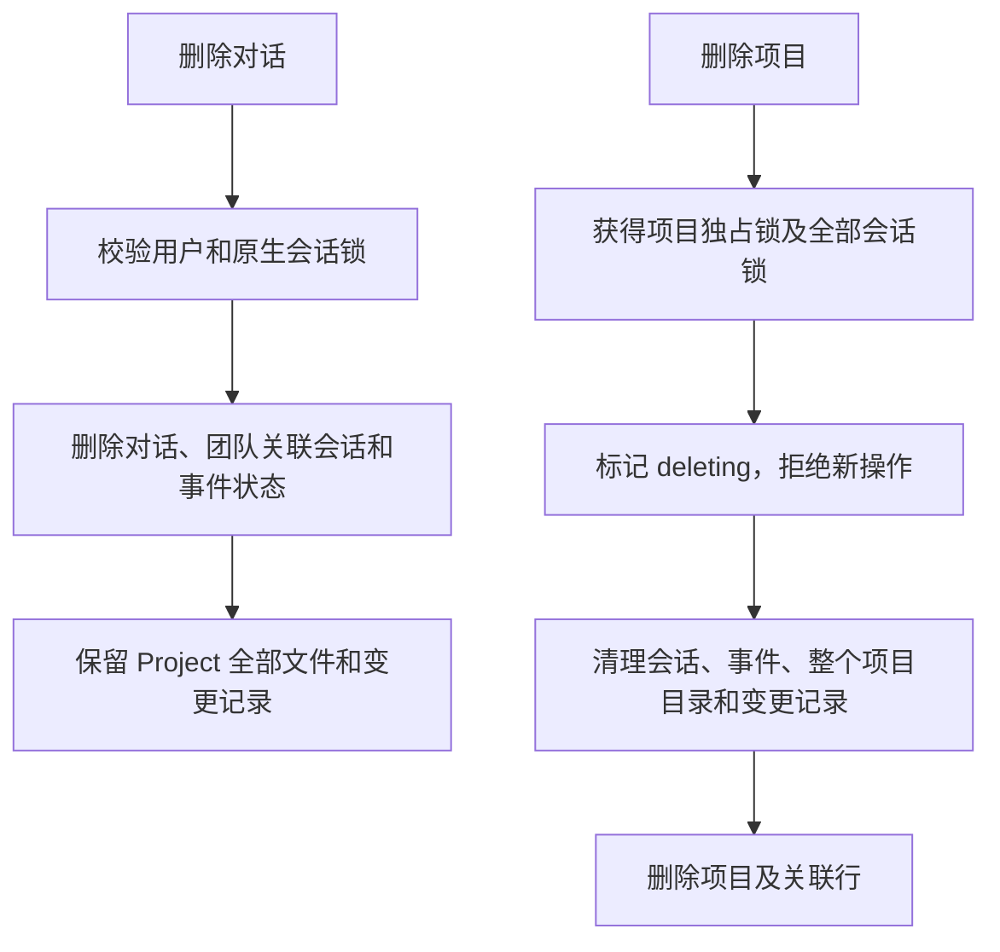

# Project 工作空间与会话生命周期

工作空间归 Project 所有；Session 只保存对话、运行状态和消息。一个 Project 可有多个 Session，所有对话使用同一份资料、过程文件、产物和变更记录。项目之间、用户之间隔离。

## 实际目录

```text
workspace/user/<user_id>/projects/<project_id>/
├── 客户资料.pdf        # 上传直接保存到项目根目录，无 uploads 目录
├── 其他上传资料/
├── .work/              # 隐藏工作目录，保存中间脚本和过程文件
└── artifacts/          # 正式交付，界面显示为“产物”
```

界面的文件列表展示根目录文件、`.work`、产物。项目名称只展开或收起会话列表，不进入项目介绍页；项目工作空间可上传和预览，即使尚无对话。切换同项目的对话会保留预览；切换项目不会带入其他项目的文件。

原生 `SessionConfig.workspace_id` 使用 Project ID，`cwd` 指向项目的 `.work`。模型可以读取项目资料；工作文件和交付分别写入 `.work` 与 `artifacts`。原生 Workspace、Tool、ChatService、SSE 继续复用，不修改 AgentScope service 源码。

## 表与接口

- `ak_projects`：`id`、`owner_id`、`project_name`、`status_type`、`is_default` 和审计字段；每个用户至多一个默认项目。
- `sessions.project_id` 从该会话的 AgentKit 状态绑定生成，并按项目和会话所有者索引。同一项目可以包含独立专家、个人助理和专家团的多个原生会话。
- `ak_workspace_file_fingerprints` 保存文件指纹，`ak_workspace_file_changes` 保存变更历史，均按 `project_id` 关联。扫描基线和扫描错误保存在项目记录中。

`/manager/projects` 提供列表、新建；`/manager/projects/<id>` 提供详情、重命名、删除。所有操作检查项目所有权。

`/manager/projects/<id>/files`、`file`、`preview`、`deliver`、`file-changes` 提供文件与预览接口。`area=uploads` 对应项目根目录，`area=work` 对应 `.work`，`area=artifacts` 对应交付目录。路径始终相对于 area，禁止绝对路径、上跳和符号链接。上传同名文件默认返回 409。显式提交 `overwrite=true` 可以覆盖。

## 交付

文档、媒体、归档等常见输出可从 `.work` 发现并交付到 `artifacts`。过程脚本与代码不会自动成为产物；如果代码本身就是用户要求的交付，明确写入 `artifacts` 或调用 `/deliver`。上传资料的原样副本不自动交付。已有产物不覆盖，内容变化保留独立版本文件。

## 删除与并发



运行、上传、读取与预览持有项目共享锁。项目删除需要独占锁。正在运行或操作中的项目返回 409，防止部分删除。删除失败保留 `deleting` 状态供重试，晚到的扫描不会重建目录。

## 回复卡片与项目产物

右侧产物面板列项目 artifacts 全量；消息下的卡片只列该会话该次回复新增或修改的交付，通过 `ak_reply_artifacts(project_id, session_id, reply_id, path, digest)` 持久关联。`GET /manager/tasks/<sid>/artifacts` 返回 reply_id，前端按原生消息 ID 归组，不能把项目全量挂到最新回复末尾。历史文件没有可靠 reply_id 时只出现在项目面板，不猜测归属。

单次 Write/Edit/Bash 使用项目文件锁并比较前后指纹，交付本次改变的正式文件，过程脚本不自动交付。锁不包住模型调用或团队唤醒。

## 工作空间删除

项目文件和自建子目录可通过文件行悬停删除按钮删除；目录删除需确认递归删除。项目根目录、`.work` 和 `artifacts` 根目录保留，后端拒绝删除，不仅隐藏前端按钮。文件操作仍使用项目归属校验和不跟随符号链接的目录描述符访问。

删除产物后，既有文件变更记录中的删除时间用于阻止自动发现把未变化的 `.work` 副本重新复制回来；后来修改/重新生成或显式交付的文件仍可成为产物。删除 session 不删除项目文件。
