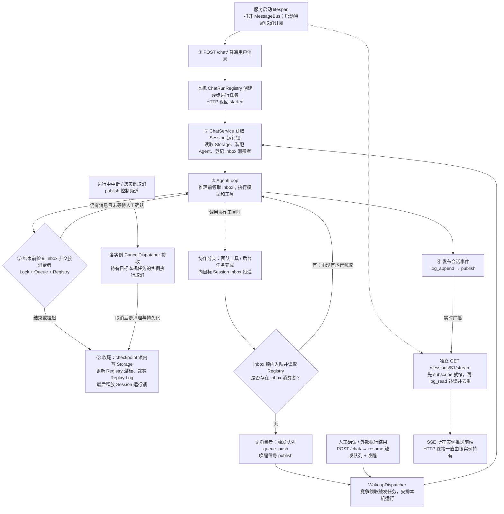
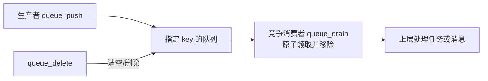
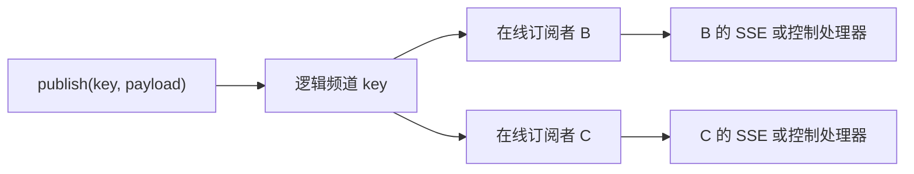
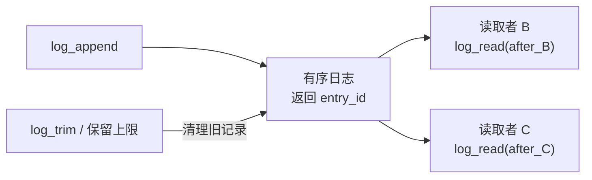
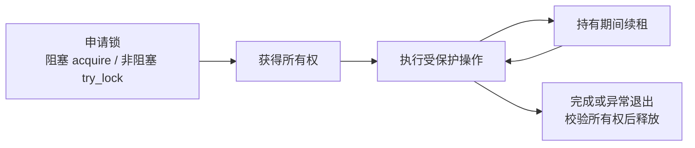
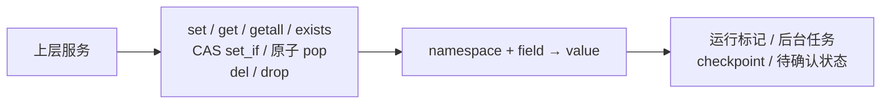
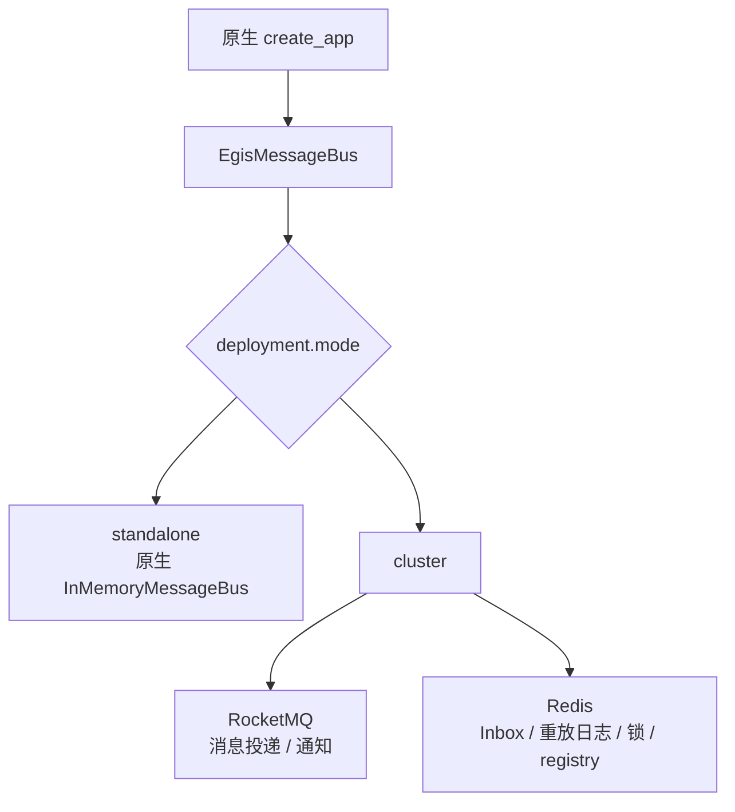
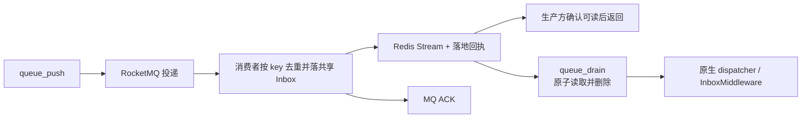
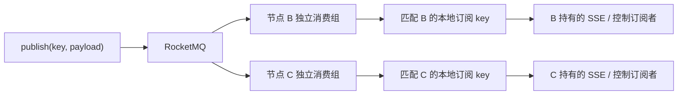

# egis-agentkit-framework 改造点草稿

更新日期：2026-11-03。

当前首版主设计已整理为 [数据结构](./数据结构.md)、[表设计](./表设计草案.md)、[运行流程](./运行流程.md)。本文保留长期工作项和历史集群方案；001 MQ 改造、sandbox/HA 等不在本版。当前只有 user/admin，私有轻量资源保存自用不审核，仅共享审核，expert 不主理，orchestrator 只团内运行，动态组团不做。

项目定位：AgentScope 的企业增强框架，Python 导入名为 `egis_agentkit`。共享的 Definition 配置管理、AgentService、发布包加载、版本选择、授权与运行适配放在 framework；HTTP Controller、Schema、可选 manager_router 和 WorkBuddy 启动组合放在 egis-agentkit-app。前端独立放在 egis-agentkit-frontend。能用原生能力就直接复用，不修改 AgentScope service 层源码，不复制 ChatService/AgentLoop。

本文记录已确认的改造方向和实施前仍需细化的事项。“已确定”表示设计决策已确认，不表示代码已实现。AgentScope 原生机制与源码索引见 [create_app机制.md](./create_app机制.md)。

核对基线：本地 `harness/agentscope` 的 `v2.0.10`，commit `e6c014f0be49b2a6f6f62a9453082a0b975484e1`。

## 运行面改造总表

按职责整理为 **14 个工作项**：001—010 是企业接入与运行增强，011 以原生交互能力对接为主，012—013 按调度和故障恢复要求启用，014 为首版必做的新增/升级包热加载。001 的方案已确定；014 的硬约束已于 2026-11-03 确认，均不表示代码已实现。首版范围、PG 表、接口、Demo 和开发顺序以 [V1实施规划](../../egis-agentkit-app/docs/V1实施规划.md) 为准。

| 编号 | 改造内容                           | 改造目标                                            | 设计方式 / 原生接入位置                                                                              | 改后怎么走                                                                                     |
| ---- | ---------------------------------- | --------------------------------------------------- | ---------------------------------------------------------------------------------------------------- | ---------------------------------------------------------------------------------------------- |
| 001  | EgisMessageBus                     | 多实例间投递、通知和协调                            | 实现原生 MessageBus；按部署模式委托不同后端                                                          | standalone → InMemory；cluster → RocketMQ 投递/广播 + Redis Inbox/日志/锁/Registry             |
| 002  | Workspace：local / sandbox         | 支持本机和公司沙箱执行，保持一致的公共/用户目录规则 | 按配置选择 Manager；local 复用 LocalWorkspace/LocalBackend，sandbox 接公司 Adapter；目录差异局部增强 | local → 解析本机目录；sandbox → 分配/重连沙箱并挂载 NAS；均返回原生 Workspace                  |
| 003  | PA_JT 模型接入                     | 使用公司推理服务和凭证体系                          | Adapter：Credential + Model；通过 extra_credentials 注册，复用兼容的模型协议实现                     | Session 模型配置 → 解析凭证 → PA_JT 模型 → 公司网关；结果继续转原生事件                        |
| 004  | Nacos、bootstrap 与配置规则        | 明确加载什么、默认值是什么、允许前端改什么          | 配置源 Adapter + 合并/校验策略；复用 create_app 和原生记录                                           | 加载企业规则 → 校验用户允许的覆盖 → 得到生效配置 → 写入原生 Agent/Session 或对应绑定           |
| 005  | 身份与权限                         | 用户可信、资源可用范围明确、工具动作受控            | HTTP 身份依赖 + 资源访问策略 + 权限 middleware；沙箱执行隔离                                         | 验证身份 → 校验 Agent/Session/资源归属 → 每次工具调用检查授权 → 沙箱执行                       |
| 006  | Skills / MCP / 函数工具 / 专家绑定 | 专家配套范围、个人动态技能及自己的资源维护真正生效 | 资源目录 Adapter + 可用范围策略；Workspace 资源列举、原生 SkillLoader/middleware、Toolkit/团队工具 | 专家只加载明确配置；个人助理动态加载个人安装技能；后端校验归属和每次调用资格 |
| 007  | 个人助理文档与偏好                           | 企业指令与用户偏好按规则生效                        | Middleware：on_system_prompt；复用原生 system_prompt                                                 | personal_config 引用用户文档 → 按规则合并提示；长期记忆走 008                                |
| 008  | ReMe 长期记忆与同步                | 按用户作用域使用 NAS 记忆，并同步数据库             | 复用 ReMeMiddleware；补路径、实例生命周期及同步 Adapter                                              | 检索相关记忆 → 注入上下文 → 原生写回记忆 → 按版本/幂等规则同步数据库                           |
| 009  | work / artifacts 交付              | 区分工作草稿与正式交付                              | 明确的交付工具/动作 + 文件与元数据适配；复用原生下载能力                                             | 在 work 工作 → 提交时校验并复制/生成交付版本到 artifacts → 登记交付记录 → 用户下载             |
| 010  | 追踪、审计与 Workspace 使用采集    | 支撑 pool、在线使用、时长和操作留痕页面             | 复用 TracingMiddleware；在 Manager/Backend/授权/交付边界发采集事件                                   | 运行面采集关联 ID、使用状态与审计 → 公共服务存储聚合 → 管理页面展示                            |
| 011  | 门户交互对接                       | 对接 Vue3/TDesign 门户，支持所需交互协议            | 复用原生 SSE / AGUI middleware；新增业务语义优先 CustomEvent                                         | 原生事件 → 按门户需要转换 → 前端渲染；确认/外部执行结果走原生恢复流程                          |
| 012  | Scheduler 高可用（条件项）         | 启用调度且要求 HA 时，避免重复触发并支持接管        | 所有权租约 + 触发幂等；复用原生调度与周期对账，或接企业调度 Adapter                                  | 获取调度权 → 按计划产生唯一触发 → 原生 Inbox/唤醒；失去所有权停调度，新 owner 接管并处理漏触发 |
| 013  | 执行中故障恢复（条件项）           | 要求进程崩溃后任务可恢复时，补齐领取后的恢复        | 持久任务状态 + 执行租约 + 幂等；局部增强领取/执行边界                                                | 登记任务 → 领取执行并保存进度 → 完成登记；失联后核对状态，再决定恢复或人工处理                 |

| 014  | 发布包新增与升级热加载（首版硬约束） | 独立发布物按需取得，主 App 不重启 | 独立命名空间、暂存注册、固定资源快照、原生工厂/Workspace；工具依赖可借 MCP 隔离，不承诺整轮 Worker | 校验并原子注册 → 选 private/shared/system 视图 → 固定装配；失败保留旧版 |

006 首版使用固定专家团，以原生 Record/Storage 预建成员，运行通信复用原生 TeamSay/Inbox，不把会立即唤醒的 AgentInvite 当静态登记函数。012、013 不因接入 RocketMQ 自动具备。014 契约见 [包边界与热加载](./包边界与热加载.md)。

首版 PG 复用已启动的 Docker PostgreSQL；运行记录复用原生 SQL Storage，企业增量使用独立 ak_ 表。不新增 Redis 依赖，开发验收使用 standalone + InMemory；001 的 RocketMQ/Redis 组合仍是独立集群目标，不因此改变为首版默认配置。

## 项目目录设计

以下为目标职责，按实现进度创建，不代表已有代码：

```text
egis-agentkit-framework/src/egis_agentkit/
├─ definitions/          # Agent/Team 当前定义与装配引用；原生类型复用
├─ services/             # Definition 配置管理、共享领域用例
├─ storage/              # 原生 StorageBase/PG 复用与必要增量
├─ packages/             # 发布物、Loader、namespace、按需缓存与MCP工具接入
├─ policies/             # 归属、资源授权、允许覆盖规则
├─ config/               # 统一Nacos接入；本地仅最小连接引导
├─ message_bus/          # 后续MQ实现；首版不建设EgisMessageBus
├─ workspace/            # 首版仅 local，优先复用原生 Manager/Workspace
├─ models/pa_jt/         # 公司模型接入，按需复用已有实现
├─ middleware/           # 原生 hook 的企业接入
├─ memory/               # ReMe 路径、模型与实例生命周期
├─ artifacts/            # 工作文件到交付的业务动作
└─ telemetry/            # 追踪与审计输出

egis-agentkit-app/       # WorkBuddy 启动、Controller、Schema、manager_router

egis-agentkit-frontend/  # Vue3 + TDesign，全部新产品页面独立在此

demo/agentscope-demo/agentkit_demo/  # 源码、构建发布物与热加载验证
```

AgentService / TeamService 的核心职责为定义、管理（内置/外部包注册、位置和发布版本）、权限及装配配置解析。AgentService 管 Agent；TeamService 管主理人和成员定义，成员仍复用 AgentService。装配配置分新建会话与每次执行两段解析，实际 Agent/Toolkit/Model/Session 由原生流程创建。删除 repositories/runtime 独立层；已有 Base、策略和 middleware 优先实现。原生 service 已有完整能力直接调用，不给每个原生类机械增加一层包装。不得修改 service 源码或 monkey patch 私有字段。

业务实现与实际发布目录分开。App 启动后，framework Loader 从配置的发布路径加载代码；前端或管理入口发布 Definition 不等于自动安装 Python 依赖。新增和升级发布包热加载都是首版硬约束。

具体职责、表与开发里程碑见 [V1实施规划](../../egis-agentkit-app/docs/V1实施规划.md)，前端独立组件见 [V1页面与组件](../../egis-agentkit-frontend/docs/V1页面与组件.md)。

## 业务 Agent 怎么开发与发布

在 `demo/agentscope-demo/agentkit_demo` 编写完整 Agent 包：registration、Definition、普通函数工具、原生 Middleware、Skills 和 MCP 声明。框架不新增一套业务 Agent 基类。

```text
业务源码
  → 构建不可变版本目录（代码、manifest、资源）
  → Loader 暂存导入并调用注册入口
  → 校验后原子发布版本化注册表快照
  → AgentService 显式发布固定装配版本的 Definition
  → 用户创建原生 Session 并运行
```

App 启动只安装一次统一工具/middleware 工厂，后续按该 Turn 固定的 Definition 和注册表版本分派。业务包升级不改 app 的硬编码 import/wiring，也不重新执行 create_app。

原生 FunctionTool/ToolBase、MiddlewareBase、Skill 目录格式直接使用；注册入口只贡献原生工厂和资源描述。Skill 源码进入包不代表已对所有 Agent/用户生效，仍需资源版本绑定、权限与 Workspace 可达性解析。

原生 Skill 示例结构：

```text
skills/project_delivery/
├─ SKILL.md
├─ scripts/
└─ references/
```

正式发布使用独立 agent-releases 根目录。开发态可用本地路径和可控测试模型调试，但首版验收必须验证 App 运行后加载实际发布目录、版本并存、真实前后端流程和无需主应用重启。

## 统一设计方式

- **Adapter 接外部**：Nacos、公司沙箱、PA_JT、资源目录、同步和采集出口各自适配。优先实现 AgentScope 已有接口，不先造一层同义接口。
- **策略处理规则**：默认/覆盖、资源可用范围、授权规则独立于具体存储与供应商；由 framework 领域 Service 统一管理与发布，Controller/运行工具复用，执行侧按版本解析。
- **Middleware 增强执行**：权限、偏好、记忆和追踪接原生 hook。和原生 hook 相关的代码集中在接入处，业务规则不散落到各个 hook。
- **组合完成装配**：直接调用原生 create_app，注入 adapter 与原生工厂；保留原生生命周期、ChatService 和 AgentLoop。没有能力缺口就不新增包装类。

## Workspace 的两种执行模式（002）

| 执行模式 | 在哪里执行命令、读写文件                                   | 复用与增强                                                                                                               |
| -------- | ---------------------------------------------------------- | ------------------------------------------------------------------------------------------------------------------------ |
| local    | API/Agent 进程所在主机的本地文件系统，也可使用已挂载的 NAS | 复用原生 LocalWorkspace / LocalBackend；Manager 默认路径不符合用户隔离与目录规则时，仅适配绑定和路径，不复制本地执行能力 |
| sandbox  | 公司沙箱内执行，通过挂载访问 NAS                           | 实现公司 Sandbox 的 Manager / Workspace / Backend 接入，处理分配、重连、挂载和回收                                       |

两种模式采用相同的逻辑目录规则：common/{agent_id}/{assembly_version}/skills 是 Agent 配套只读资源；user/{user_id} 是实际用户的正常工作区，包含 .mcp、data、skills、work、artifacts、memory、sessions。物理根目录可以不同。系统专家只用配套 Skills，个人助理可动态加载个人安装技能，自建专家只用明确绑定集合；用户只能维护自己的专家/专家团/Skill。详见 [Workspace与用户资源范围](./Workspace与用户资源范围.md)。Pool、sandbox_id 和沙箱租约只用于 sandbox；local 仍采集 workspace 使用记录。

配置示意（项目拟定配置，不是原生 create_app 参数）：

```yaml
deployment:
  mode: standalone       # standalone / cluster：服务部署与 MessageBus 模式
workspace:
  mode: local            # local / sandbox：文件与命令执行位置
  root_dir: ./workspace  # local 的物理根；sandbox 则配置 NAS 挂载与沙箱服务
```

**两个维度独立选择。** standalone 可以使用 sandbox；cluster 也可以使用 local，但可被不同实例接手的工作区必须具有一致的共享文件视图和并发协调。bootstrap 选择对应 Manager 后直接注入原生 create_app，无需新增统一 Workspace 包装类。

## 改后初始化流程

```text
① bootstrap 从 Nacos 读取配置并校验
   配置包括：部署模式、连接引用、默认值/覆盖规则、功能开关与发布包路径；注册表监听运行后变更
                    ↓
② 准备共享 Storage、EgisMessageBus，按 local/sandbox 选择 WorkspaceManager
   注册 PA_JT 凭证类型，准备权限策略与 middleware/tools 工厂
                    ↓
③ 直接调用原生 create_app(...)
                    ↓
④ 原生 lifespan 打开组件、创建 Service、启动唤醒/取消等后台任务
   企业额外客户端和记忆实例按各自生命周期打开/关闭
                    ↓
⑤ 服务就绪；具体 local/sandbox 工作区、会话 Agent 和 MCP 按需取得
```

Agent 定义由管理端发布为可运行记录；需要启动同步时按稳定 ID/版本幂等同步。进程启动不等于创建所有 Agent，也不无条件覆盖已有配置。

## 改后完整聊天流程

```text
准备会话：可信身份 → 选择已发布 Agent → 合并默认值与允许的用户设置
          → 保存原生 Session 配置及资源绑定
                    ↓
① 前端 POST /chat/：agent_id + session_id + input
   企业入口校验身份、归属和授权；原生提交运行，返回 started
                    ↓
② 原生 ChatService 获取 Session 锁，加载记录与状态
                    ↓
③ WorkspaceManager 按 local/sandbox 取得本机目录或公司沙箱工作区
   资源适配提供可用 Skills/MCP/工具/专家；原生装配 Toolkit 和模型
                    ↓
④ 原生 Agent 带会话状态运行
   middleware 加偏好/记忆、检查动作权限、记录追踪和审计
                    ↓
⑤ 原生事件写 Replay Log 并广播；SSE/AGUI 推前端
   子 Agent、后台结果、人工确认继续走原生协作和恢复流程
                    ↓
⑥ 有正式交付动作时：work → artifacts + 交付登记
   结束时原生保存 Msg/State、更新 checkpoint、释放锁
   ReMe 写回与数据库同步按记忆方案处理
```

共享配置在装配时按明确版本读取，普通变更按约定的下一次装配生效；紧急禁用/撤权在动作执行前校验。确认恢复沿用原会话状态，不因重新套默认值而覆盖待确认动作。后台唤醒、子 Agent、定时触发也执行相同的企业授权规则。

## 目录与外围职责

用户目录采用 **work 与 artifacts 分开、仍位于同一个用户根下**，可按 session_id 区分任务；`.mcp` 保持原生声明文件语义，`data/` 与 `sessions/` 复用原生卸载能力，`context.jsonl` 不代替 Storage 中完整会话记录。公共 Skills 只读共享，不逐用户复制或给用户逐项开启；用户技能只在个人助理动态范围或自建专家明确绑定范围内生效，不扫描全目录混入系统专家。

| 内容                                                         | 谁负责                                                               |
| ------------------------------------------------------------ | -------------------------------------------------------------------- |
| Agent/Skills/专家/MCP/工具的编辑、发布、上下架及用户偏好设置 | 外挂公共管理服务；运行面只读取、绑定、校验和执行                     |
| 沙箱服务/pool 总览、在线用户、时长和留痕页面                 | 管理服务聚合展示；002/010 提供接入和采集，公司沙箱提供自身 pool 状态 |
| Vue3 + TDesign 页面                                          | 门户工程，不放进 Python agentkit                                     |
| 共享 Storage、统一 download_secret、Topic/消费组、凭证引用   | 部署配置，优先使用现有实现，不单独算新框架模块                       |
| 知识库                                                       | 本期不建设；Index 消费可靠性在启用知识库时再纳入                     |

实施顺序建议：先做 004 的配置契约，接通 002/003/005 的单机聊天；并行推进 001 的集群底座，再接 006—011。012/013 根据服务可用性目标安排。以下保留 001 的详细设计和多实例可靠性清单，便于逐项落地。

## 改造点 001：EgisMessageBus

**状态：已确定，是第一个改造点。当前仅记录设计，尚未实现代码。**

### 1. MessageBus 本身的设计

#### 1.1 职责与边界

MessageBus 是 AgentScope app 层的**通信与协调基础设施**：向服务提供统一的队列、广播、重放日志、锁和协调状态接口，让会话与后台任务能够在一个或多个进程之间配合运行。

它不执行 AgentLoop，也不代替 Storage。Storage 保存 AgentRecord、SessionRecord 和历史 Msg；MessageBus 负责运行中的投递、通知、并发控制和相关协调数据。队列里的 payload 可以是任务、HintBlock、事件或控制信号，不等同于核心 Msg 类型。

业务通过逻辑 key 和 JSON 风格的 payload 调用能力。key 是某个队列、日志、频道、锁或 registry 的标识；它不是网络连接，也不自动表示某个实例。上层 app 约定 key 命名，后端负责相应的数据与消费语义。

#### 1.2 五类核心能力：每项一句话

| 能力                | 一句话描述                                                   | 原生接口组                                   | 典型用途                                           |
| ------------------- | ------------------------------------------------------------ | -------------------------------------------- | -------------------------------------------------- |
| 队列 Queue          | 将消息放入指定队列，由竞争消费者中的一个原子领取并移除。     | queue_push / queue_drain / queue_delete      | 会话 Inbox、运行触发、后台任务投递                 |
| 广播 Pub/Sub        | 将一条实时消息送给同一频道当前所有在线订阅者。               | publish / subscribe                          | SSE 实时事件、取消通知、唤醒信号                   |
| 重放日志 Replay Log | 按顺序保留消息，让不同读取者各自按游标补读并按规则裁剪。     | log_append / log_read / log_trim             | SSE 断线补读、事件 checkpoint 衔接                 |
| 分布式锁 Lock       | 让同一资源在同一时间只由一个有效持有者操作。                 | acquire_lock / is_locked / try_lock / unlock | 同一 Session 串行执行、Inbox 交接、checkpoint 协调 |
| 协调状态 Registry   | 保存可跨调用或跨实例查询、条件更新和原子取走的命名空间字段。 | registry_*                                   | Inbox 消费者标记、后台任务、游标、待确认投影       |

**生命周期是配套能力：统一打开、就绪和关闭总线使用的连接与后台任务。** 对应 __aenter__ / aclose / __aexit__，不另算第六种消息消费语义。

#### 1.3 必须分清的语义

- Queue 是竞争领取；Pub/Sub 是多订阅者分发；Replay Log 是各自持游标读取，三者不能互相替代。
- 原生 queue_drain 读出即删除，是 at-most-once 交付，不等于 Agent 任务完成后 ACK。
- 原生 Pub/Sub 只承诺在线实时订阅，历史恢复由 Replay Log 负责。
- Registry 包含恢复所需的协调数据，不全是“丢失无所谓”的缓存。

### 2. 典型用途在整体运行流程中的位置

#### 2.1 一次会话运行的全貌

MessageBus 横跨 app 的启动、会话运行、异步协作、前端交互和收尾恢复；不是在 AgentLoop 后面额外挂一个事件队列。下面描述的是 **AgentScope 2.0.10 已有的 app 调用流程**，EgisMessageBus 替换这些调用的底层实现，不重新设计业务流程。



图中 SSE 是独立长连接，可以先于或后于某次运行建立。执行实例 A 与 SSE 实例 B 可以不同，传递的是事件数据；Agent 对象、模型调用、工具执行和 HTTP 连接都留在各自进程。一次运行内的多轮推理仍由同一个本机 Agent 对象推进。

第⑤步表示正常结束的 Inbox 交接检查；失败、中断、等待人工确认等退出路径另有清理。等待确认的 Agent 不会因为收到普通 Inbox 消息就绕过确认继续推理，后续通过 resume 输入恢复。

#### 2.2 典型用途对照：谁在何时调用什么能力

| 整体位置         | 典型用途                                                      | 原生调用方与动作                                                                                                                              | 使用的 MessageBus 能力                                  | 解决的问题                                                                                    |
| ---------------- | ------------------------------------------------------------- | --------------------------------------------------------------------------------------------------------------------------------------------- | ------------------------------------------------------- | --------------------------------------------------------------------------------------------- |
| 服务启动         | 让本实例具备接收通知和调度任务的能力                          | lifespan 打开 bus，启动 WakeupDispatcher / CancelDispatcher 的订阅；唤醒分发器也检查已有触发任务                                              | 生命周期、Pub/Sub、Queue                                | 不依赖某个 HTTP 请求临时创建全局消费者                                                        |
| ① 普通用户输入   | 用户发送一条新消息                                            | `/chat/` 路由直接调用本机 ChatRunRegistry.spawn，随后进入 ChatService                                                                         | 路由这一步不经过 Queue；下一步使用 Lock                 | 接收请求与持续运行解耦；不能理解为所有用户请求都先进入 MQ                                     |
| ② 开始运行       | 避免同一个 Session 被两个实例同时推进                         | ChatService 先取得 Session 运行锁，再读 Storage、装配 Agent；进入循环前登记 Inbox 消费者                                                      | Lock、Registry                                          | 串行推进会话，并告知投递方本次运行会负责领取 Inbox                                            |
| ③ 每轮推理前     | 接收其他 Agent 或后台任务发来的新信息                         | InboxMiddleware.queue_drain，将领取的 HintBlock 注入当前 AgentState                                                                           | Queue                                                   | 让已运行的 Agent 在推理边界读到协作信息，无需迁移或重建 Agent                                 |
| 协作分支         | 创建子 Agent 并交付初始任务；TeamSay 发送任务或回报           | 工具经 deliver_to_inbox 向目标 Session 入队，检查消费者标记；没有消费者才投递唤醒触发                                                         | Queue、Lock、Registry；需唤醒时加 Pub/Sub               | 运行中的目标自己读 Inbox，空闲目标由 dispatcher 安排运行；团队任务不通过 A2A 网络调用         |
| 异步工具分支     | 长工具后台执行、完成后通知 Agent                              | BackgroundTaskManager 用 Registry 登记/移除任务元数据；完成结果交付 Inbox，按交接规则唤醒                                                     | Registry、Queue、Lock、Pub/Sub                          | Agent 可获知任务及其结果；实际 asyncio.Task 仍由创建它的进程持有                              |
| ④ 生成事件       | 将文本增量、工具进度、回复结束等交给前端                      | ChatService 调 publish_session_event：先 log_append，再 publish；StateChangeMiddleware 也发布任务/权限/团队更新事件                           | Replay Log、Pub/Sub                                     | 同时提供短期补读与实时分发；两步是独立调用，原生不提供原子双写                                |
| SSE 建连或重连   | 刷新页面、断线后衔接当前运行                                  | SSE 路由先订阅就绪，再按 after 游标 log_read，重叠部分按 entry_id 去重，之后读实时订阅                                                        | Pub/Sub、Replay Log                                     | 衔接补读与实时事件；历史 Msg 和快照由 Storage 提供，不靠无限期保留事件                        |
| 人工确认分支     | 子 Agent 申请确认，用户批准后恢复对应 worker                  | SubagentHitlProjector 将待确认投影放 Registry 并通知 leader；确认输入由路由定位 worker，enqueue_run_trigger(kind=resume) 后由 dispatcher 领取 | Registry、Replay Log、Pub/Sub、Queue；恢复运行再用 Lock | leader 页面展示确认卡片，确认结果进入正确 worker；worker 的持久状态仍是判断是否等待确认的依据 |
| 运行中控制       | 用户中断、删除会话时取消任务、ToolStop 取消其他实例的后台任务 | 发布对应控制频道；各实例 CancelDispatcher 检查本机运行/任务，仅持有者实际处理                                                                 | Pub/Sub；部分路径先查 Lock 或 Registry                  | 调用方无需知道任务在哪个实例；不在运行中的中断则以 resume 触发传入 UserInterruptEvent         |
| ⑤ 准备结束       | 避免“最后一次读 Inbox 后又来一条消息”被漏掉                   | has_pending_inbox_or_release 在 Inbox 锁内检查队列；有消息继续运行，无消息清消费者标记；异常路径另行交还消费责任                              | Lock、Queue、Registry                                   | 协调投递方与退出方，决定继续当前运行还是后续唤醒                                              |
| ⑥ 收尾与快照衔接 | 保存本次运行结果，让前端快照和事件游标对齐                    | ChatService 在 checkpoint 锁内写历史 Msg/SessionState 到 Storage，再写 Registry 游标、log_trim，最后释放运行锁                                | Lock、Registry、Replay Log；业务数据写 Storage          | 下次运行读到已保存状态；前端用快照加剩余事件衔接，避免重放已归档内容                          |

按能力倒过来看：**Queue 主要出现在“交付与触发”，Pub/Sub 出现在“通知与实时分发”，Replay Log 出现在“事件补读”，Lock 出现在“开始、交接和收尾”，Registry 出现在“跨阶段的协调标记与投影”。** 五类能力被上层组合使用，不是五个独立业务流程。

可选模块也使用这些原语，例如启用知识库索引后会用索引任务队列与唤醒通知。它们不意味着普通聊天的每次请求都要走一遍这些分支；本次不展开未纳入建设范围的知识库。

#### 2.3 以“子 Agent 完成后回报主 Agent”为例

1. 子 Agent 的 TeamSay 把回报封装为 HintBlock，调用 deliver_to_inbox，目标是**主 Agent 对应的 Session Inbox**。
2. 投递方在 Inbox 锁内 queue_push，并读 Registry 中的消费者标记，避免与主 Agent 的结束交接发生竞态。
3. 若主 Agent 正在消费 Inbox，投递方不额外启动它；主 Agent 的 InboxMiddleware 在推理边界领取，或结束检查发现尚有消息后继续一轮。
4. 若没有消费者，投递方写运行触发队列，再广播唤醒信号；某个 WakeupDispatcher 领取触发任务，安排 ChatService 获取 Session 锁、读取持久状态并运行。若主 Agent 正等待人工确认，则保持挂起，等确认恢复后处理消息。
5. 主 Agent 读到回报后决定下一步。它产生的可展示事件走 Replay Log + Pub/Sub，由持有 SSE 的实例送给前端；结束后写 Storage 并更新 checkpoint。

这里一次协作就串起了五类能力；MessageBus 承担投递和协调，是否继续委派、如何解释回报，仍由原生 Agent 的模型与工具流程决定。

### 3. 各能力的通用流程

本节只描述 MessageBus 的能力契约，不先绑定内存、Redis 或 RocketMQ；不同部署模式都应保持这些可观察行为。

#### 3.1 队列：投递 → 竞争领取 → 处理



一个条目只交给一个领取者。领取后的处理成功与否不在原生 drain 的 ACK 协议里；queue_push 成功返回时，后续 drain 必须能够看见已入队数据。

#### 3.2 广播：发布 → 匹配频道 → 所有在线订阅者



同 key 的 B、C 均接收；未订阅该 key 的实例不接收。SSE 连接仍由建立它的实例持有，总线只转发数据。历史事件不能仅靠重新 subscribe 恢复。

#### 3.3 重放日志：追加 → 各自按游标读取 → 裁剪



读取不删除，B、C 可以读取同一条记录。日志的长度与 checkpoint 决定重放范围；它不是无限期的业务历史或审计存储。

#### 3.4 锁：申请 → 持有并续租 → 释放



is_locked 用于查询占用。阻塞 acquire 在有效操作期间续租；try_lock 的租期与释放遵守其接口约定。实现必须处理所有权失效，不能让旧持有者释放新持有者的锁。

#### 3.5 Registry：按命名空间读写协调状态



set_if 表示值符合预期才更新，pop 表示读取与删除是同一个原子操作；TTL 作用于 namespace，未配置 TTL 的记录不能擅自短期过期。

### 4. EgisMessageBus 的模式实现与差异

#### 4.1 模式选择与整体实现

对外统一命名为 **EgisMessageBus**，实现原生 MessageBus 接口。

| 部署模式     | 行为                            | 适用范围                    |
| ------------ | ------------------------------- | --------------------------- |
| `standalone` | 直接委托原生 InMemoryMessageBus | 本地开发、单进程部署        |
| `cluster`    | RocketMQ + Redis 的组合实现     | 共享会话的多进程/多副本部署 |

讨论中的 local 就是 standalone，不再增加第三个 `local` 配置值。standalone 也不是“一个容器可以启动多个独立 worker”；该模式要求共享运行状态的服务只有一个进程。

已确定的原则：

1. 公司企业高可用 RocketMQ 承担集群消息投递与通知。
2. Redis 承担锁、协调状态和原子操作。
3. 首版适配方案中，按 key 领取的 Inbox 与短期重放日志也使用 Redis Stream，保留原生调用契约。MQ 负责投递，Redis 负责可查询/可领取的数据视图。
4. standalone 全面复用 InMemory；cluster 的简单 Redis 原语复用其算法，仅对真实差异新增实现或加固。
5. 不 fork 原生实现，不另造 AgentLoop、团队调度框架或 EnterpriseRuntime。
6. 配置字段是本项目拟定 schema，不是 AgentScope 已有参数；本文尚未生成 Python 实现。

这里的“复用 RedisMessageBus”指复用经过核对的命令逻辑/算法；可以委托的直接委托。不是复制整个类再混杂 MQ 逻辑，也不依赖上游私有 Lua 常量。企业 Redis Cluster 客户端、MQ 接入和锁加固仍需自己实现。



#### 4.2 各能力在两种模式下的实现与差异

| 能力       | standalone                         | cluster 首版适配方案                                               | 实现差异                                                       |
| ---------- | ---------------------------------- | ------------------------------------------------------------------ | -------------------------------------------------------------- |
| Queue      | 原生进程内队列                     | RocketMQ 投递到共享 Redis Inbox；落地确认后返回，按 key 原子 drain | 本地调用变为跨系统投递，需要回执、去重、删除代际和 TTL 适配    |
| Pub/Sub    | 原生内存订阅者集合与 asyncio.Queue | MQ 节点级消费者按 key 分发给本节点订阅者                           | 原生单进程分发变为跨实例分发，需要区分竞争消费与广播           |
| Replay Log | 原生内存日志与游标                 | Redis Stream                                                       | 内存随进程退出消失；共享日志可被其他实例读取，仍受保留策略约束 |
| Lock       | 原生进程内互斥                     | Redis 分布式锁，所有者 token、续租和安全释放                       | standalone 只在进程内有效，cluster 要处理租约与失锁            |
| Registry   | 原生进程内映射                     | Redis Hash 与单 key Lua                                            | cluster 跨实例共享，需保留原子性及 namespace 级 TTL            |
| 生命周期   | 进入/退出原生 InMemory             | 打开/关闭 MQ、Redis 和后台消费任务                                 | cluster 需要连接就绪、异常恢复与统一关闭                       |

standalone 的所有能力直接委托原生实现；cluster 以下分别说明真实接入差异，再给出逐方法复用清单。

#### 4.3 cluster：Queue 的投递与按 key 领取

原生 MessageBus 接口允许按任意 key 调用 queue_drain；它不等同于 MQ consumer 的 Topic 拉取。首版使用共享 Redis Inbox 兼容这层接口，避免每个 Session 创建 consumer，也避免仅缓存到某个进程内存。



- queue_push 不能收到 broker 发送成功就立即返回。原生 Inbox 交接协议依赖“push 返回时已可读”；否则唤醒先到、消息后到，可能出现漏消费。
- MQ 消费者先原子完成去重、Inbox 写入和回执，再 ACK；持久落地失败不 ACK，按 MQ 策略重试。所需 Redis 原子操作的相关 key 在 Cluster 中安排到同一 hash slot。
- queue_push 超时可能属于“实际已成功、回执未返回”的不确定结果；重试需使用稳定消息 ID，不能无条件生成新 ID 造成重复任务。原生接口没有幂等键参数，必要时由调用处提供内部操作上下文；不能仅对 payload 做 hash，就把两次合法的相同任务合并。
- queue_delete 需要逻辑队列代际/删除标记，避免 MQ 滞留消息将已经删除的会话 Inbox 重新创建；标记保留周期需覆盖消息最大存活与重试窗口。
- TTL 要保持原生“队列级滑动 TTL”语义，不能简单替换为每条 MQ 消息 TTL。
- 这里的 MQ ACK 表示“已可靠交接给共享 Inbox”，不表示 Agent 已完成任务。queue_drain 仍保留原生读出即删除语义；读取后进程崩溃的端到端任务恢复，需要持久任务状态或消费者局部增强，不能宣称已经 exactly-once。
- 这个方案仍会在 Redis 保存待领取的消息 payload。若后续要求 payload 完全不进入 Redis，就需另行调整原生按 key drain 的调用/恢复协议，不能仅替换实现名称。

#### 4.4 cluster：Pub/Sub 的节点分发

每个逻辑节点维持进程级消费者，将收到的消息按逻辑 key 分发到本节点订阅者。多个本地 SSE 订阅同一个 key 时都接收；无本地订阅时不建立临时 Session consumer。



- queue 的投递消费者采用同组负载分担；broadcast 的节点组独立消费，两种语义不能混用。
- subscribe 的 on_ready 只能在 MQ 消费链路和本地订阅都就绪后触发，不能只表示启动了一个后台 task。
- 原生 subscribe 是实时订阅；MQ 的历史积压不能无条件发给后来订阅者。需处理订阅边界、消费起点、重投递去重；历史恢复走 log_read。
- 用户取消信号由持有该任务的节点处理，其他节点忽略；执行 Agent 的 HTTP 连接不会在节点间迁移。
- 同一运行的文本/工具增量需要有稳定顺序标识与 event_id；结合 MQ 分组、有序发送/消费及幂等验证，不按时间戳猜顺序。
- 本地缓冲溢出应按配置断开并触发补读路径，不静默丢掉中间文本块；慢 SSE 需要入口一起配合。
- disconnect/重放策略面向可重放事件。唤醒、取消等控制订阅需要独立的循环恢复策略：唤醒恢复后重新检查共享触发队列；需要可靠取消时保存取消意图并核对运行状态。不能把“断开 SSE 后重连”当作所有控制信号的恢复方式。

#### 4.5 cluster：Replay Log 的 Redis 实现

流程沿用第 3.3 节，存储后端替换为共享 Redis Stream。

- 三个 log 方法沿用原生 Redis Stream 语义和 cursor，不拿 MQ 消费位点替代会话游标。
- 当前 publish_session_event 分别调用 log_append、publish，两次写入仍不具备跨后端事务性。需有发送失败可见性、补发/补读与去重；不得因接入 MQ 就宣称原子发布。
- 重放日志有长度与裁剪边界，不是完整审计或任务状态。超出范围后应从 Storage 的消息快照和 checkpoint 恢复。
- MQ 消费确认不表示浏览器已收到；不能把 ACK 当作 SSE 客户端确认。

#### 4.6 cluster：Lock 的 Redis 实现与加固

流程沿用第 3.4 节，进程内互斥替换为带所有者 token 的 Redis 租约锁。

Session 运行锁、Inbox 交接锁、checkpoint 锁，以及启用后的 SOP/实时会话锁都走这些原语。

不能照搬原生“直接 EXPIRE 续租、GET 后 DEL 释放、try_lock 用固定值、unlock 裸 DEL”的全部做法。EgisMessageBus 内部记录所有者，续租失败/所有权丢失要通知或取消原操作。极端故障下阻止过期 owner 写入，还需要持久状态写入端的 fencing/版本校验，不能仅靠心跳承诺。

#### 4.7 cluster：Registry 的 Redis 实现

流程沿用第 3.5 节，进程内映射替换为共享 Redis Hash；条件操作使用单 key Lua。

普通读写直接复用，CAS 和原子读取删除复用原生 Lua 算法。保留 namespace 级 TTL；未指定 TTL 的状态不能擅自增加短过期时间，尤其待确认请求可能长时间存在。registry 是协调状态，不能一律当作可丢缓存。

#### 4.8 原生接口逐项实现清单

以下是 MessageBus 的 20 个抽象方法，加生命周期。standalone 全部委托原生 InMemory；下表重点列 cluster 如何实现。

| 功能/接口                         | 功能描述                               | cluster 实现                                             | 复用或自研                               |
| --------------------------------- | -------------------------------------- | -------------------------------------------------------- | ---------------------------------------- |
| `__aenter__ / aclose / __aexit__` | 建立和释放资源                         | 初始化 Redis/MQ、启动投递与广播消费者，退出时关闭        | 自研模式选择与组合生命周期               |
| `queue_push`                      | 将数据投递到指定逻辑队列 key           | MQ 发送 → 共享 Redis Inbox 落地确认 → 返回条目 ID        | 自研投递、回执、去重、超时处理           |
| `queue_drain`                     | 按 key 原子领取一批并移除              | Redis Stream，XRANGE + XDEL 的单 key Lua                 | 复用原生 drain 算法                      |
| `queue_delete`                    | 删除逻辑队列                           | 删除 Redis Inbox，并阻止 MQ 中未落地的旧代消息重新写入   | 复用 DEL，自研代际/删除标记              |
| `log_append`                      | 追加可重放事件                         | Redis Stream，XADD，保留 max_len/TTL                     | 复用原生命令逻辑                         |
| `log_read`                        | 按游标读取后续事件，不删除             | Redis Stream，XRANGE 独占起点                            | 复用原生命令逻辑                         |
| `log_trim`                        | 按游标裁剪或删除日志                   | Redis Stream，XTRIM MINID / DEL                          | 复用原生命令逻辑                         |
| `publish`                         | 发布实时事件/控制通知                  | RocketMQ broadcast topic，带逻辑 key 和 event_id         | 自研 MQ 发布、重投递、幂等标识           |
| `subscribe`                       | 订阅指定 key，支持多个监听者           | 节点 MQ 消费者 → 本节点 key/订阅者集合 → async generator | 自研广播分发、就绪、清理和恢复           |
| `acquire_lock`                    | 阻塞获取互斥锁，运行期间续租，退出释放 | Redis SET NX + token；Lua 校验所有者后续租/释放          | 复用思路，必须加固                       |
| `is_locked`                       | 判断锁是否存在                         | Redis EXISTS                                             | 复用原生命令逻辑                         |
| `try_lock`                        | 非阻塞抢锁                             | Redis SET NX EX + 唯一 token                             | 复用思路，补所有权记录                   |
| `unlock`                          | 释放 try_lock 所获锁                   | Lua 比较 token 后 DEL                                    | 自研安全释放，不能沿用裸 DEL             |
| `registry_set`                    | 设置命名空间字段和可选 TTL             | Redis HSET + EXPIRE                                      | 复用原生语义；TTL 与写入需要一致时原子化 |
| `registry_get`                    | 读单字段                               | Redis HGET                                               | 复用原生命令逻辑                         |
| `registry_getall`                 | 读命名空间全部字段                     | Redis HGETALL                                            | 复用原生命令逻辑                         |
| `registry_exists`                 | 判断字段存在                           | Redis HEXISTS                                            | 复用原生命令逻辑                         |
| `registry_del`                    | 删单字段                               | Redis HDEL                                               | 复用原生命令逻辑                         |
| `registry_drop`                   | 删整个命名空间                         | Redis DEL                                                | 复用原生命令逻辑                         |
| `registry_set_if`                 | 值符合预期才更新，即 CAS               | Redis 单 key Lua：比较 HGET 后 HSET，按需续 TTL          | 复用原生 Lua 算法                        |
| `registry_pop`                    | 原子读取并删字段                       | Redis 单 key Lua：HGET + HDEL                            | 复用原生 Lua 算法                        |

原生基类中的可复用便利方法和 app 的 _bus_ops 继续使用上述原语；不额外复制一套 session/inbox/team 业务接口。RocketMQ 消息 ID、Redis Stream entry_id 与 event_id 分别表示不同层的标识，不能混用。

### 5. 接入与配置

#### 5.1 原生接口与装配

```python
from agentscope.app.message_bus import MessageBus
```

拟定装配形态如下。构造参数是设计示意，不代表已有可调用代码：

```python
from agentscope.app import create_app

bus = EgisMessageBus(
    deployment=config.deployment,
    config=config.message_bus,
)

app = create_app(
    storage=storage,
    workspace_manager=workspace_manager,
    message_bus=bus,
)
```

原生 create_app 负责调用 bus 的异步生命周期；EgisMessageBus 按模式建立真实后端。

#### 5.2 standalone

```yaml
deployment:
  mode: standalone

message_bus:
  type: EgisMessageBus
```

该模式不要求 MQ/Redis 配置，也不初始化相关客户端；锁、队列、日志、订阅与 registry 全部使用原生内存实现。

#### 5.3 cluster

```yaml
deployment:
  mode: cluster
  node_id: ${EGIS_NODE_ID}       # 每个运行进程唯一的逻辑节点标识

message_bus:
  type: EgisMessageBus
  namespace: egis:agentkit:prod   # 环境/应用隔离；统一映射原生 key

  rocketmq:
    endpoints: ${ROCKETMQ_ENDPOINTS}
    credential_ref: secret://agentkit/rocketmq
    delivery_topic: egis-runtime-delivery
    delivery_consumer_group: egis-runtime-delivery
    broadcast_topic: egis-runtime-broadcast
    broadcast_consumer_group: egis-runtime-broadcast-${EGIS_NODE_ID}

  redis:
    topology: cluster           # Redis 本身的拓扑，与 deployment.mode 区分
    startup_nodes:
      - host: ${REDIS_HOST_1}
        port: 6379
      - host: ${REDIS_HOST_2}
        port: 6379
    credential_ref: secret://agentkit/redis

  delivery:
    confirm_timeout_seconds: 10 # 发送方等待共享 Inbox 落地确认的示例上限

  replay:
    backend: redis_stream
    max_len: 1000               # 与原生默认重放上限一致，需容量验证

  subscription:
    max_buffer_events: 1024     # 本地订阅缓冲上限示例
    overflow: disconnect       # 断开后按游标补读，不能静默丢文本增量
```

配置说明：

- 上述超时、缓冲大小是待压测的初始值，不是已经验证的生产参数。
- node_id 必须唯一到进程；示例分发方案以每个逻辑节点一个广播消费组为前提。多 worker 共用一个组会再次变成负载分担，不能照此使用。
- Topic、消费组、认证按公司运维规范预建/管理；不会按 Session 动态建 Topic/消费组。节点规模很大时，广播拓扑需另行评估。
- 首版示例采用节点间独立消费组分发；具体 Python SDK/公司 MQ 版本支持与消费起点要在接入时验证。
- Redis 示例是原生分片 Cluster；若公司提供代理入口，需要选择相应客户端模式并验证 Streams/Lua 等命令。不是修改 host 就认为已经支持 Cluster。
- secret_ref 和环境变量由应用的配置/凭证接入解析，不在文档中写真实密钥。
- mode 不合法，或 cluster 配置不完整时启动失败；cluster 故障不自动降级为 standalone。
- 原生 SSE 路由另有无上限 asyncio.Queue。上面的 subscription 配置只能约束 EgisMessageBus 自己的缓冲；要贯通前端背压，需对 SSE 入口做小范围配套增强，不能声称仅配置 bus 就已解决。

### 6. 新增实现与局部加固范围

| 类别       | 需新增或修改的内容                                              |
| ---------- | --------------------------------------------------------------- |
| 模式选择   | EgisMessageBus 根据 standalone/cluster 委托对应实现             |
| MQ 传输    | producer/consumer、认证、Topic 映射、广播与竞争消费分开         |
| 队列兼容   | 按 key 共享 Inbox、MQ 落地回执、稳定 ID 去重、删除代际、TTL     |
| 订阅       | 进程级 MQ 消费到本地多订阅者分发、就绪、关闭、恢复与缓冲上限    |
| Redis 接入 | 企业 Cluster/代理客户端、key 命名空间、Lua 原子操作的 slot 安排 |
| 锁加固     | token、原子续租/释放、try_lock 所有权与失锁处理                 |
| 恢复闭环   | 重投递去重、日志/通知双写失败处理、任务交接不确定结果           |
| 配套入口   | 若启用 SSE 背压与完整补读，对原生 SSE/消费边界做窄范围适配      |

可照原生命令逻辑实现的是：Stream 日志三方法、Inbox drain Lua、registry 大部分方法、锁存在性查询。standalone 则完全使用原生 InMemory，不复制实现。

### 7. 实施前待确认与验收

待确认的是公司 RocketMQ 版本/Python SDK、消费组资源管理、企业 Redis 拓扑和容量参数。上面的功能划分与最小兼容方案已明确，实际接入验证后再确定具体驱动 API。

验收场景：

- standalone 不连接 Redis/MQ；cluster 配置错误不静默降级。
- A 执行、B 持有 SSE 时可收事件；B/C 同订阅一个 Session 时均能收到。
- MQ 投递未落地时 queue_push 不提前报告可读；重投递不会重复写 Inbox。
- 删除队列后旧 MQ 消息不会复活 Inbox；TTL 与原生契约一致。
- Session 不跨实例并发执行；长任务续租、失锁与旧 owner 写入处理正确。
- 重启/断线恢复在日志保留范围内可补读，增量有序且不重复展示。
- 慢前端不导致无上限内存积压；所有后台消费者和连接可关闭。
- 区分“broker 接收”“共享 Inbox 落地”“原生消费者领取”“Agent 完成”“浏览器收到”，逐段验证，不笼统承诺 exactly-once。

### 8. 源码与参考

- [MessageBus 抽象接口](../../../harness/agentscope/src/agentscope/app/message_bus/_base.py)
- [原生实现导出](../../../harness/agentscope/src/agentscope/app/message_bus/__init__.py)
- [RedisMessageBus](../../../harness/agentscope/src/agentscope/app/message_bus/_redis_message_bus.py)
- [事件发布与 Inbox 交接](../../../harness/agentscope/src/agentscope/app/_bus_ops.py)
- [服务启动与装配](../../../harness/agentscope/src/agentscope/app/_lifespan.py)
- [聊天入口与确认恢复](../../../harness/agentscope/src/agentscope/app/_router/_chat.py)
- [ChatService 运行与收尾](../../../harness/agentscope/src/agentscope/app/_service/_chat.py)
- [InboxMiddleware 推理前领取](../../../harness/agentscope/src/agentscope/app/middleware/_inbox_middleware.py)
- [StateChangeMiddleware 状态更新事件](../../../harness/agentscope/src/agentscope/app/middleware/_state_change_middleware.py)
- [后台任务管理](../../../harness/agentscope/src/agentscope/app/_manager/_background_task_manager.py)
- [子 Agent 人工确认投影](../../../harness/agentscope/src/agentscope/app/_service/_projectors/_subagent_hitl.py)
- [WakeupDispatcher](../../../harness/agentscope/src/agentscope/app/_manager/_wakeup_dispatcher.py)
- [CancelDispatcher](../../../harness/agentscope/src/agentscope/app/_manager/_cancel_dispatcher.py)
- [SSE 订阅与重放](../../../harness/agentscope/src/agentscope/app/_router/_session.py)
- [RocketMQ 消费者与组内消费语义](https://rocketmq.apache.org/docs/domainModel/09consumer/)
- [RocketMQ 顺序消息](https://rocketmq.apache.org/docs/featureBehavior/03fifomessage/)
- [Redis Pub/Sub 交付语义](https://redis.io/docs/latest/develop/pubsub/)

## 多实例部署与可靠性改造清单

本节记录多实例运行面的分档处理结论。第一档明确共享组件与部署约束，第二档补齐消息交接、订阅恢复和执行故障的处理边界；分档不表示第二档可以在需要可靠性保障的生产环境中省略。

当前仅完成设计文档，尚未实现 EgisMessageBus。下表是总表 001、002、005、010、012、013 在多实例场景的交叉检查；配置事项不另设编号，Scheduler 高可用和执行中故障恢复按条件进一步细化。

### 第一档：多实例基础接入

| 项目            | 处理结论                                                                                                                                                                                                                 |
| --------------- | ------------------------------------------------------------------------------------------------------------------------------------------------------------------------------------------------------------------------ |
| MessageBus      | 拟实现 EgisMessageBus：standalone 复用原生 InMemory；cluster 使用 RocketMQ + Redis，不直接使用原生 RedisMessageBus。RocketMQ 承担消息投递与广播；Redis 承担锁、Registry、Replay Log，以及兼容原生按 key 领取的共享 Inbox |
| Storage         | 所有实例使用共享 Storage，统一保存 Agent、Session、Msg 等记录；保留用户隔离与归属校验                                                                                                                                    |
| Workspace       | 支持 local / sandbox：local 复用本地执行，sandbox 接公司 Sandbox + NAS；两者补跨实例工作区绑定与共享文件协调，sandbox 另处理分配/重连。共享 NAS 不自动解决沙箱重复分配或并发修改                                         |
| Scheduler       | 若启用，保证只有一个有效调度者；要求高可用时，补租约所有权、故障接管和触发幂等。仅固定一个实例 enable_scheduler=true 是单调度者部署，不等于自动故障接管                                                                  |
| 认证            | 接入正式认证，从可信身份解析 user/tenant，替换直接信任客户端 X-User-ID 的方式；后台唤醒与子 Agent 运行也要能恢复相应授权上下文                                                                                           |
| download_secret | 所有实例配置同一份稳定密钥，属于部署配置；不使用每进程随机生成的默认值                                                                                                                                                   |

### 第二档：可靠性补强

| 项目                  | 处理结论                                                                                                                                                                              |
| --------------------- | ------------------------------------------------------------------------------------------------------------------------------------------------------------------------------------- |
| MQ ACK、失败重投、DLQ | EgisMessageBus 按公司 RocketMQ 能力实现。队列投递在完成去重、共享 Inbox 落地及回执后再 ACK；配置重试、DLQ、告警和人工重放。广播消费的 ACK 另按节点接收/分发边界定义，不等于浏览器收到 |
| 消费幂等              | 使用稳定消息/操作标识处理重复投递；调度触发与有副作用的业务动作分别确定幂等策略，不能只依赖 MQ 消息去重                                                                               |
| 分布式锁              | 续租和释放校验 ownership；失锁后停止受保护操作；关键状态写入按需增加 CAS/fencing。后者需要 Storage/实际写入端配合，不能仅靠 MessageBus 内部实现                                       |
| Wakeup 恢复           | 连接恢复、订阅重建后重新检查共享触发队列，并安排周期检查或等价补偿，覆盖“队列有任务，但唤醒通知丢失”的情况；启动时原生已有一次初始 drain，继续复用                                    |
| Cancel 恢复           | 恢复订阅并监控消费者存活；若要求取消请求不能丢，保存取消意图、重试并检查结果，校验目标运行标识/代际，防止旧请求取消后续新运行                                                         |
| Index 恢复            | 知识库启用后再纳入；复用原生任务租约与 sweeper 补偿机制，补订阅恢复、消费者存活监控与告警。本阶段不因清单出现 Index 就启用知识库                                                      |
| 会话事件可靠性        | 处理“日志已写入、广播失败”的情况；结合补发/补读、去重、有序性和 SSE 缓冲上限完成恢复。MQ ACK 不等于 SSE 客户端确认                                                                    |
| 执行中故障恢复        | 如要求实例崩溃后任务可恢复，补持久执行状态、租约和恢复规则；对外部副作用定义重试/幂等边界，不能只靠 MQ 重投保证 Agent 任务最终完成                                                    |

### MQ ACK 与 Agent 执行完成的边界

当前首版队列适配方案的顺序是：

```text
RocketMQ 投递
    ↓
去重、写入共享 Inbox、生成落地回执
    ↓
MQ ACK：确认已交接给共享 Inbox
    ↓
原生 queue_drain：领取并删除
    ↓
Agent 执行
    ↓
保存消息与会话状态
```

MQ ACK 确认的是“已交接给 Inbox”，不是“Agent 已完成”。原生 queue_drain 领取即删除；若进程在领取后、执行完成前崩溃，RocketMQ 不会因 Agent 没做完而自动重投。这一段的恢复需要单独的持久任务状态或消费者局部增强。

广播链路也必须分清“MQ 接收”“节点接收/分发”和“浏览器收到”；不能把最后一项包含在 broker 的 ACK 保障里。

### 订阅恢复与业务补偿的责任

- **EgisMessageBus**：尽量统一承担底层连接恢复、订阅重建、就绪状态、本地分发以及连接/消费异常可观测性。
- **对应消费者**：Wakeup 重新检查触发队列，Cancel 核对取消意图，SSE 按游标补读事件；需要连接恢复通知时做窄范围适配。不把“自动重连”直接等同于“业务已恢复”。
- **Scheduler**：原生已有配置变更订阅重试和周期对账，继续复用；缺口是调度者自动接管、跨节点触发去重，以及接管时漏触发的补偿策略。触发幂等不自动保证工具外部副作用幂等。
- **监控**：除连接断开外，还需发现后台消费循环已退出、订阅未就绪、重连持续失败、队列积压和业务补偿失败，避免进程存活但运行服务已失效。

源码对照：[SchedulerManager](../../../harness/agentscope/src/agentscope/app/_manager/_scheduler/_scheduler_manager.py)、[WakeupDispatcher](../../../harness/agentscope/src/agentscope/app/_manager/_wakeup_dispatcher.py)、[CancelDispatcher](../../../harness/agentscope/src/agentscope/app/_manager/_cancel_dispatcher.py)、[IndexTaskConsumer](../../../harness/agentscope/src/agentscope/app/_service/_index_task_consumer.py)。完整初始化与聊天对照见 [create_app机制.md 第 13 节](./create_app机制.md#13-企业运行面对照初始化与完整聊天)。

