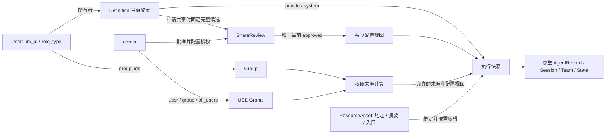

# V1 数据结构

日期：2026-11-03。设计评审稿，未编码、建表。主文档按顺序阅读：[数据结构](./数据结构.md) → [表设计](./表设计草案.md) → [运行流程](./运行流程.md)。

## 1. 本轮确定的边界

- 不修改 AgentScope service 源码；会话、团队执行、消息、状态、事件与工具执行复用原生能力。
- 用户只有 user / admin 两类角色；管理员管理全部资源、用户、Group 和授权，不设组管理员或发布者角色。
- Group 是用户分组，不是专家团 Team。用户基本信息、分组和角色要落 PG，不建设“用户画像资料”模块。
- 私有轻量专家/专家团/Skill 保存后即可自用，无发布审核。共享给其他用户才需管理员审核，首版共享默认全部用户。
- 系统代码资源注册后不自动授 USE，管理员在授权页面显式配置；没有直接/继承授权来源就拒绝，管理员管理资格不等于运行时 USE。
- 每用户的 personal 默认可用，来自管理员预配置的个人助理使用规则，不由运行中的 Agent 临时授予。
- personal / expert / orchestrator 三类 Agent；expert 不当主理人，orchestrator 只能团内运行，V1 不开放动态组团。
- Definition 仍只保存当前配置，绑定在 payload；没有草稿版本、独立修订表，历史回退后续最多保留最近 5 版。
- 用户后续授权 Kafka：standalone 使用原生 InMemory；cluster 接 Kafka + PG。Workspace 首版 local。
- 配置管理统一用已安装的 Nacos，保存运行参数/默认值/规则；用户、Definition、授权、审核等具体业务对象保存在 PG，边界见 [配置管理](./配置管理.md)。

## 2. User、Group 与角色

### User

```json
{
  "user_id": "zhangsan",
  "username": "张三",
  "group_ids": ["GROUP-OPTIM"],
  "role_type": "user",
  "is_enabled": true
}
```

user_id 使用公司 um_id，稳定且唯一；username 为中文姓名，不要求唯一。role_type 默认 user，只能由可信管理员入口赋予/修改。普通请求不能通过 Header/body 自报 admin。

### Group

```json
{
  "group_id": "GROUP-OPTIM",
  "group_name": "优化系统组",
  "is_enabled": true,
  "users": [{"user_id": "zhangsan", "username": "张三"}]
}
```

users 是查询视图，存储的成员关系只放 User.group_ids，不两边重复保存。一个用户可属于多个 Group。管理员维护组、成员、角色；首版不做组管理员和组织层级继承。

| 操作 | user | admin |
| --- | --- | --- |
| 个人助理、维护自己的轻量专家/团/Skill | 可以 | 可以 |
| 注册/修改系统代码 Agent、Tool、Middleware | 不可以 | 可以 |
| 管理用户、Group、角色 | 不可以 | 可以 |
| 看授权/审核管理页面 | 不可以 | 可以 |
| 给用户/Group/全部用户配 USE、审核共享 | 不可以 | 可以 |
| 运行系统/共享资源 | 根据 USE 判断 | 同样根据 USE 判断，不因 admin 自动放行 |

角色控制管理操作；资源授权控制使用范围；原生 Permission 控制单次工具 ALLOW/ASK/DENY，三者分开。



图中的引用不都代表数据库外键；例如 Group 成员关系只保存 User.group_ids，权限绑定在配置 JSON 中，运行数据继续使用原生模型。

## 3. AgentDefinition 与 TeamDefinition

| agent_type | 独立运行 | sub-agent | 主理人 |
| --- | --- | --- | --- |
| personal | 可以，含 agent.md/soul.md/user.md 偏好 | 不作为被邀请专家 | 将来可动态组团；V1 不做 |
| expert | 可以 | 可以 | 不可以 |
| orchestrator | 不可以 | 不能冒充 expert 被邀请 | 只在 Team 内编排 |

每用户一个 personal，由初始化幂等取得。编译原生配置时 personal/orchestrator 的 invitable=false；expert 才可作为固定成员，并提供有效 invite_description。

普通用户轻量配置由 system_prompt + Skill/MCP 引用和少量允许的模型设置组成，不能提交任意 Python Tool、Middleware 或包入口。系统代码 Agent 则由管理员注册，可以包含专业 Tool/Middleware/Skills/MCP。

“不带自定义 Tool”不等于移除原生 Read/Bash 等工作区能力；这些基础工具是否开放由平台规则控制。

所有 Agent 均保存在同一张 ak_definitions；orchestrator 由 TeamService 通过团队编辑器管理，不出现在可单独召唤的专家列表。原生仍构造普通 Agent 类，不新增三个 Agent 基类。

### AgentDefinition 示例

```json
{
  "id": "EXP-U100",
  "definition_type": "agent",
  "agent_type": "expert",
  "owner_type": "user",
  "owner_id": "zhangsan",
  "agent_name": "my-reviewer",
  "agent_display_name": "我的评审专家",
  "is_enabled": true,
  "config_version": 2,
  "shared_review_id": null,
  "shared_version": 0,
  "payload": {
    "agent_data": {"name": "my-reviewer", "system_prompt": "根据规范评审需求。", "chat_config": {}},
    "implementation": {"source_type": "internal", "assembly_ref": "egis.lightweight-expert", "assembly_version": "1.0.0"},
    "session_defaults": {},
    "allowed_overrides": ["chat_model_config.model"],
    "bindings": {"skills": [{"resource_id": "SK-REQ", "resource_version": "1.0.0"}], "mcps": []},
    "personal_config": null
  }
}
```

agent_data 复用原生 AgentData，name 由 agent_name 生成，不是第二份可独立编辑的名称。agent_display_name 是前端中文名。owner_type=user/system，owner_id 为 um_id/系统名称；映射原生系统 user_id 时才使用 system:egis-delivery 命名空间。

系统代码实现的 implementation 还包含 package_id、package_path、entrypoint。包信息继续放 Definition，固定 assembly_ref/version；普通用户无权自行写这些字段。

### TeamDefinition 示例

```json
{
  "id": "TEAM-U100",
  "definition_type": "team",
  "owner_type": "user",
  "owner_id": "zhangsan",
  "team_name": "my-delivery-team",
  "team_display_name": "我的交付团",
  "is_enabled": true,
  "config_version": 1,
  "shared_review_id": null,
  "shared_version": 0,
  "payload": {
    "instructions": "编排者拆分任务，专家完成分工，再汇总。",
    "bindings": {
      "orchestrator_agent_id": "ORCH-U100",
      "experts": [{"agent_id": "EXP-U100", "instructions": "评审需求"}, {"agent_id": "EXP-DEV", "instructions": "形成研发方案"}]
    }
  }
}
```

主理人必须是 orchestrator，成员必须是 expert，同团运行英文名不能冲突。专家可被多个团引用；Skill/Tool/MCP 也可被多个 Agent 引用，不是独占归属。

personal_config 仅 personal 使用，保存三个偏好文档引用和加载规则；长期记忆通过原生 ReMeMiddleware，不维护第二份 memory.md。

## 4. 私有自用、系统注册、共享发布

| 场景 | 谁保存/发布 | 审核 | 谁可以用 |
| --- | --- | --- | --- |
| 用户私有轻量专家/团/Skill | 所有者 | 不需要 | 本人按管理员预配置的私有自用规则可用；不能借此获得其他系统资源的权限 |
| 系统代码资源注册 | admin | 不另加普通用户共享审核 | 初始无 USE，管理员显式授权后可用 |
| 用户申请共享 | 所有者提交，admin 审核 | 只做共享审核 | 通过后由管理员的批准动作显式配置共享 USE，默认 all_users |

共享不把 owner 改为 system，不允许别人编辑源配置。申请中、被拒绝均不影响所有者已经可用的私有版本。is_enabled 和 is_skill_market_visible 都不授予 USE。

### ShareRequest

```json
{
  "review_id": "SHARE-001",
  "resource_type": "team",
  "resource_id": "TEAM-U100",
  "submitted_by": "zhangsan",
  "review_status_type": "pending",
  "is_current": false,
  "shared_version": 0,
  "share_scope_type": "all_users",
  "source_versions": {"TEAM-U100": 1, "ORCH-U100": 1, "EXP-U100": 2},
  "snapshot": {"definitions": [], "resource_refs": []}
}
```

snapshot 实际保存完整待共享配置及依赖闭包，此处省略正文；不是指向用户可继续改动的最新 payload。首版只审核共享，不设置 review_type=publish。

审核通过将共享快照冻结，将它设为该资源唯一 is_current=true 的 approved 记录，shared_version 递增，并由管理员动作配置对应共享视图的 all_users USE。Definition 查询视图中的 shared_review_id/shared_version 由这条记录关联得出，不在定义表另存一份指针。这样 Agent、Team、Skill 使用同一套共享当前版本规则。

对外执行读取这份通过的快照；自己继续改 prompt/Skill 只影响私有 payload。更新共享需再申请审核，不能自动传播未审修改。共享更新复用该资源的共享授权来源，不因每次批准多插一条 all_users 来源。

这份当前共享快照不是用户草稿或历史回退功能。同一资源有私有和共享两个使用视图，用 definition_view_type=private/shared/system 区分，仍只有一张 Definition 表。权限边同样使用所选视图的 bindings，不能拿私有最新边扩充共享授权。

对于从共享 Team 继承使用的成员/能力，授权结果需携带根共享申请 ID 和路径，配置从该根审核闭包取得，不要求每个子节点都另外有独立共享申请；也不能回落到原作者当前私有配置。多个来源不只返回 allowed=true，而是保留可用的来源视图。

Team 共享需要固定编排者、用户自建成员和资源引用的审核闭包。不能把个人 memory、user.md、私有会话或原始 MCP 密钥复制给其他使用者；资源文件用发布物只读缓存，运行仍进入使用者的工作区。

## 5. Skill、Tool、Middleware 与发布物

| 数据 | 位置/复用 |
| --- | --- |
| 运行态 Skill | 原生 name/description/dir/markdown/updated_at |
| 用户技能库/安装引用 | 原生 SkillRecord，已有 id/version/enabled 和 hub/card 信息 |
| MCP 声明与客户端 | 原生 MCPRecord/Workspace，活连接只在内存 |
| 完整文件包、下载地址、SHA-256、入口 | 企业 ResourceAsset；不把 ZIP 内容放 PG |

```json
{
  "resource_type": "skill",
  "resource_id": "SK-REQ",
  "resource_version": "1.0.0",
  "owner_type": "system",
  "owner_id": "egis-delivery",
  "download_url": "https://artifacts.example/skills/req/1.0.0.tar.gz",
  "checksum_sha256": "实际为64位十六进制摘要",
  "is_enabled": true,
  "payload": {"agent_id": "EXP-PM", "name": "requirement-analysis", "description": "需求分析", "is_skill_market_visible": true}
}
```

is_skill_market_visible 只表示是否在技能广场展示。true 可展示，false 不展示；系统某个 Agent 的配套 Skill 同样可以 true，不需要复制成另一份通用资源。归属、共享审核、使用、安装和编辑分别判断。未共享的用户私有内容不会仅因该字段为 true 就对其他人发布。

该企业字段放 ResourceAsset 的 Skill 扩展元数据，不修改原生 SkillRecord。用户安装系统 Skill 只建立自己的原生安装引用，不改变源资源所有者。

按需时机：Skill 首次受控查看/调用取得完整文件；Tool 首次权限解析/使用取得真实实现；Middleware 在所选 Agent 的首次装配、Agent.__init__ 之前取得；MCP 复用原生按声明连接，不一律下载。

系统/共享文件只存一份只读缓存，不按用户复制；Skill 附属 scripts/references 必须保留。同名不同资源拒绝绑定或激活，不依赖 Toolkit 的覆盖顺序。

独立包加载请求可先于 Definition：管理员提供位置 → 校验 manifest → 登记资源/装配描述 → Definition 选择固定版本。注册元数据不等于下载所有实现，也不创建 USE。

## 6. SessionBinding 与执行快照

```json
{
  "session_binding": {"definition_id": "ORCH-U100", "definition_view_type": "shared", "runtime_agent_id": "RT-U200-TEAM100", "agent_type": "orchestrator", "team_definition_id": "TEAM-U100", "root_session_id": "S-ROOT", "is_initialized": true},
  "execution_snapshot": {"execution_id": "E-001", "reply_id": "R-001", "definition_versions": {}, "agent_snapshots": {}, "resource_refs": [], "session_config": {}, "registry_refs": []}
}
```

企业结构放原生 SessionRecord.state.middle_context.egis_agentkit。快照实际包含完整配置/引用，不能只存版本号后回读已覆盖的主表。不存模型客户端、MCP 连接、密钥或 Python 工厂，不增加 turn/state 表。

| 内容 | 固定范围 |
| --- | --- |
| personal/expert 运行段 | 一次原生持锁运行段，可含多个 reply；确认/外部结果恢复沿用原快照，新运行段可选择允许的新配置 |
| 固定专家团 | 当前团队任务/会话的成员和版本固定，新团任务使用新配置 |
| 用户共享资源 | 只读取当前有效的通过审核的共享快照，不读取私有最新修改 |
| 个人助理个人技能集合 | 按已有资格安装/启停后可刷新；已开始调用固定所用内容 |

## 7. 定义 ID 与原生运行 ID

personal/用户 expert 默认可用定义 ID；系统共享 expert 可保留 system 命名空间的原生记录。orchestrator 必须创建当前运行用户所有的投影，使用独立 runtime_agent_id，不能直接用系统/其他用户所有的定义记录当 leader。

即使运行投影属于使用者，也不赋予其修改模板/共享快照的资格。原生投影写接口封口；实际配置由 Storage Adapter 在执行作用域中提供固定视图。公共技能仍按 definition_id 定位，不能按运行投影每人复制。

## 8. Msg、Event、文件

Msg/Block/AgentState、原生 agents/sessions/teams/messages/skills/mcps/credentials 继续复用。Core 事件生成器没有队列，不等于 Service 没有原生 MessageBus；事件进入原生日志/广播后给 SSE，历史从 PG messages 读取。context.jsonl 是卸载文件，不代替完整历史。

work 是编辑过程，artifacts 是正式交付。记忆和工作文件始终属于实际使用者，不随专家共享。

## 9. 五份参考材料的采用与修正

- [agent.md](/Users/frankie/Downloads/agent.md)：采用构造/状态/middleware 分工；可持久化的是 State/配置，不是活 Agent 客户端。
- [workspace.md](/Users/frankie/Downloads/workspace.md)：采用装配/声明/实例/offload 边界，不直接改 .mcp 文件期待热更新。
- [message-event.md](/Users/frankie/Downloads/message-event.md)：采用 Core 契约，补 Service 总线、PG 消息历史边界。
- [skill (1).md](</Users/frankie/Downloads/skill (1).md>)：采用零复制、公开技能接口和空 seed；修正全 Agent 扫公共区、共享 _read_only 集合保护删除、SkillRecord 无 version/enabled 等说法。
- [listtool.md](/Users/frankie/Downloads/listtool.md)：采用来源清单，补角色过滤、按需实例化和同名校验，不将 Middleware.list_tools 视为自动鉴权。
